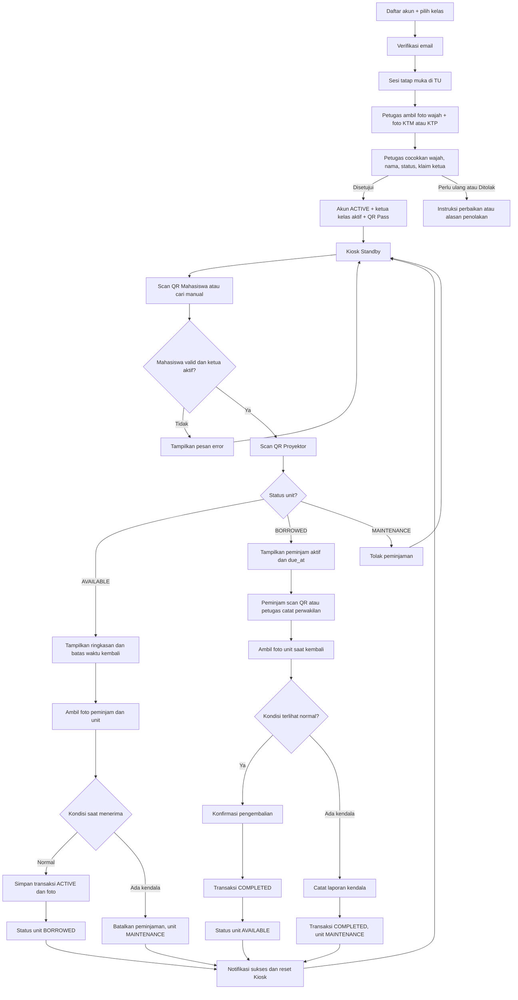

# PRD — SmartProjex (Sistem Peminjaman Proyektor Pintar Berbasis Dual-Scan)

> Dokumen ini adalah **sumber kebenaran** project. Kode mengikuti PRD. Jika kebutuhan berubah, ubah PRD dulu, baru kodenya.

---

## 0. Ringkasan

- **Produk**: Aplikasi web peminjaman proyektor kampus berbasis pemindaian ganda (QR Pass Ketua Kelas + QR Proyektor), verifikasi tatap muka oleh petugas TU, klaim ketua kelas per kelas, dokumentasi foto transaksi, konfirmasi kondisi sederhana, dan pemantauan batas waktu pengembalian.
- **Untuk siapa**: Ketua Kelas (peminjam utama) dan Petugas Tata Usaha (TU)/Laboratorium Kampus.
- **Masalah yang diselesaikan**: Menggantikan pencatatan buku besar manual dan penitipan KTP fisik dengan pencatatan transaksi digital, verifikasi awal ketua kelas, pelacakan unit secara real-time, pelacakan keterlambatan, dan bukti dokumentasi.
- **Stack utama**: Next.js 15 (App Router), Tailwind CSS, Supabase (PostgreSQL, Auth, Storage), `html5-qrcode`.
- **Status project**: Perencanaan (Siap dieksekusi di Google Antigravity)
- **Terakhir diperbarui**: 5 November 2026 (Revisi 3)

---

## 1. Overview

### 1.1 Latar Belakang
Saat ini, proses peminjaman proyektor di kampus mengharuskan ketua kelas mengantre untuk menulis data dan tanda tangan di buku besar, serta menyerahkan KTP fisik sebagai jaminan. Metode ini menimbulkan antrean, risiko data tidak terbaca, risiko KTP tertukar/hilang, dan kesulitan melacak ketersediaan setiap unit. SmartProjex mengganti pencatatan tersebut dengan pemindaian QR melalui webcam laptop, pencatatan waktu otomatis, dan dokumentasi foto.

Aturan yang berlaku saat ini adalah **hanya ketua kelas yang mengambil proyektor**, dan SmartProjex mempertahankan aturan itu. Karena UNIMED belum menerbitkan KTM untuk setiap mahasiswa, **KTP dan KTM diterima setara** sebagai dokumen verifikasi saat registrasi. Petugas tidak perlu mengelola daftar ketua kelas: ketua kelas ditentukan melalui klaim pendaftar pertama pada tiap kelas, yang tetap harus disetujui petugas.

Karena KTP tidak lagi ditahan sebagai jaminan, sistem menambahkan **batas waktu pengembalian dan pelacakan keterlambatan** sebagai pengganti fungsi pengikat tersebut. Untuk menjaga transaksi tetap cepat, pemeriksaan fisik terperinci tidak dilakukan pada setiap transaksi; pemeriksaan petugas dilakukan ketika ada laporan kendala atau indikasi kerusakan. Pengembang tidak memiliki akses ke API database pusat kampus (SIAKAD), sehingga sistem dirancang mandiri.

### 1.2 Tujuan
- **T-01**: Memangkas waktu transaksi peminjaman dan pengembalian secara signifikan; target awal maksimal 15 detik untuk transaksi normal setelah alur diuji.
- **T-02**: Menghilangkan pencatatan buku tulis manual dan penitipan KTP fisik melalui pencatatan digital dan dokumentasi foto transaksi.
- **T-03**: Menyediakan informasi ketersediaan setiap unit proyektor secara *real-time* berdasarkan status unit.
- **T-04**: Menyediakan jejak transaksi yang dapat ditelusuri jika ketua kelas melaporkan kendala atau petugas menemukan kerusakan.
- **T-05**: Menyediakan batas waktu pengembalian dan daftar unit yang belum kembali sebagai pengganti fungsi jaminan KTP fisik.
- **T-06**: Menegakkan aturan "hanya ketua kelas aktif yang dapat meminjam" tanpa petugas mengelola daftar nama ketua kelas.

### 1.3 Target User (Persona)
| Peran | Deskripsi | Kebutuhan utama | Kendala saat ini |
|-------|-----------|-----------------|------------------|
| **Ketua Kelas (Peminjam)** | Perwakilan kelas yang mengambil proyektor sebelum kelas dimulai. | Meminjam dan mengembalikan proyektor secepat mungkin tanpa meninggalkan KTP. | Antre menulis di buku besar, takut KTP hilang/tertukar. |
| **Petugas TU / Admin** | Staf ruang perlengkapan yang menjaga dan menyerahkan unit proyektor. | Mengetahui siapa yang membawa proyektor tertentu, sampai kapan, dan memastikan unit kembali utuh. | Repot mengecek buku manual dan mencari KTP saat pengembalian; tidak tahu unit mana yang terlambat kembali. |

### 1.4 Success Metrics
| Metrik | Kondisi sekarang | Target |
|--------|------------------|--------|
| Durasi per transaksi pinjam/kembali | Estimasi 120 - 180 detik (tulis manual); ukur ulang dengan stopwatch pada 10 transaksi sebelum pilot | Target awal ≤ 15 detik untuk transaksi normal, diukur saat pilot |
| Transaksi tanpa penitipan KTP fisik | 0% (semua menitipkan KTP) | 100% transaksi tanpa jaminan kartu fisik |
| Kelengkapan data peminjam & waktu | Bergantung pada pencatatan manual | Data akun + timestamp server + foto dokumentasi pada 100% transaksi |
| Transaksi yang butuh intervensi manual petugas (QR gagal baca, pencarian manual, foto ulang) | Tidak diukur | Dicatat selama pilot; target awal ≤ 10% |
| Unit melewati batas waktu tanpa kembali | Tidak terlacak | Terlihat di dashboard secara real-time; jumlahnya dievaluasi saat pilot |

---

## 2. Scope

### 2.1 In Scope (Fase 1 / MVP)
- Registrasi mandiri ketua kelas dengan verifikasi email, memilih kelas dari daftar baku, lalu verifikasi tatap muka di meja TU: petugas mengambil foto wajah referensi dan foto dokumen identitas (**KTM atau KTP, setara**) melalui kamera perangkat petugas, mencocokkan wajah, nama, dan status, lalu menyetujui atau menolak.
- **Klaim ketua kelas**: pendaftar pertama pada kelas yang belum punya ketua menjadi calon ketua dan disetujui petugas; kelas yang sudah punya ketua memerlukan persetujuan petugas untuk penggantian; ketua dapat mengalihkan jabatan ke mahasiswa lain yang sudah terverifikasi di kelas yang sama; status ketua kedaluwarsa tiap semester.
- Pembuatan **QR Pass Ketua Kelas** di layar HP berupa token bertanda tangan berumur singkat (60 detik, diperbarui otomatis) setelah akun `ACTIVE` dan menjadi ketua aktif.
- Halaman **Kiosk Scanner** di laptop petugas yang membaca 2 QR (QR Mahasiswa & QR Proyektor) menggunakan webcam laptop, termasuk **jalur cadangan** pencarian manual oleh petugas jika HP/QR bermasalah.
- Pengambilan dan penyimpanan foto wajah referensi saat registrasi serta foto dokumentasi transaksi melalui webcam. Foto peminjaman menampilkan orang yang secara fisik mengambil proyektor bersama unit; foto pengembalian berfokus pada unit dan, jika memungkinkan, orang yang menyerahkannya.
- Konfirmasi sederhana satu langkah dengan dua pilihan, baik saat menerima maupun mengembalikan: **"Kondisi terlihat normal"** atau **"Laporkan kendala"**; tanpa checklist komponen.
- **Batas waktu pengembalian (`due_at`)** dan daftar unit yang belum kembali/terlambat.
- Logika *Smart Toggle*: server menentukan transaksi pinjam atau kembali dari status unit, disertai ringkasan transaksi dan konfirmasi sebelum penyimpanan.
- Pengelolaan inventaris per unit fisik: setiap proyektor memiliki kode dan QR unik serta status masing-masing, lengkap dengan riwayat perubahan status.
- Pengelolaan kelas dan semester oleh admin.
- Dashboard Admin untuk melihat buku besar digital, dokumentasi foto, status unit, unit terlambat, riwayat perubahan status, dan audit akses foto.
- Peran petugas (`STAFF`) dan admin (`ADMIN`) dengan akun individual, serta pembersihan foto otomatis sesuai masa retensi.

### 2.2 Out of Scope (TIDAK boleh dikerjakan)
- Integrasi langsung ke API SIAKAD / PDDikti pusat kampus.
- Pencocokan wajah biometrik otomatis (*Facial Recognition matching*). Foto wajah registrasi dan foto transaksi adalah referensi visual yang dibandingkan secara manual oleh petugas.
- OCR dan pembacaan otomatis KTM/KTP pada MVP (KTP tidak memuat NIM, dan verifikasi dilakukan tatap muka). Sistem tidak menyimpan NIK atau teks hasil baca dokumen.
- Aplikasi native Android / iOS (semua berbasis Web Responsif).
- Sistem booking/reservasi jadwal proyektor jauh-jauh hari.
- Pembayaran denda keterlambatan online (Payment Gateway) dan penetapan sanksi otomatis.
- Serah-terima langsung antar kelas tanpa pengembalian melalui Kiosk (unit harus dikembalikan lebih dulu).
- Peminjaman lebih dari satu unit sekaligus oleh satu ketua kelas.
- Akun mahasiswa non-ketua kelas untuk meminjam (hanya ketua kelas aktif).

### 2.3 Asumsi dan Batasan
- **Perangkat Keras**: 1 unit laptop standar di meja petugas dengan webcam internal minimal 720p dan koneksi internet. Satu webcam melayani pembacaan QR HP, pembacaan QR unit, dan foto dokumentasi; kelayakannya wajib diuji pada hari pertama (lihat Timeline Fase 0).
- **Anggaran**: Rp 0 (free-tier Supabase dan Vercel). Konsekuensi yang diperhitungkan: project Supabase free dapat dijeda jika tidak aktif, kuota storage terbatas (1 GB), dan tidak ada backup otomatis (lihat NFR-10 dan Risiko).
- **Akses Data**: Tidak ada database awal mahasiswa maupun daftar ketua kelas dari kampus. Database terbentuk saat pendaftaran; validasi awal dilakukan petugas secara tatap muka.
- **Dokumen identitas**: KTM dan KTP diterima setara karena UNIMED belum menerbitkan KTM untuk semua mahasiswa. KTP tidak memuat NIM dan tidak membuktikan status mahasiswa, sehingga petugas memastikan status mahasiswa/ketua kelas melalui cara yang ditentukan TU (mis. menanyakan langsung atau melihat KRS di HP) dan mencatat hasil pemeriksaannya.
- **Kelas**: Satu kelas = satu rombel tetap per kombinasi program studi + angkatan + rombel (mis. A/B/C) pada satu semester. Daftar kelas diisi admin sekali per semester. *(Asumsi; lihat Open Question.)*
- **Inventaris**: Setiap unit proyektor dicatat sebagai satu baris aset tersendiri. Jumlah tersedia, dipinjam, dan dalam perawatan dihitung dari status masing-masing unit.
- **Batas waktu pinjam**: Default `due_at` adalah akhir jam operasional TU pada hari peminjaman (nilai dapat diubah admin).
- **Satu pinjaman aktif per ketua kelas** pada satu waktu.
- **Pemeriksaan kondisi**: Tidak ada checklist rutin. Petugas TU memeriksa fisik hanya jika ada laporan kendala, kerusakan, atau indikasi masalah.
- **Tanggung jawab kerusakan/keterlambatan**: Sistem hanya menyediakan bukti dan daftar; keputusan sanksi mengikuti kebijakan TU/kampus di luar sistem.

---

## 3. Requirement

### 3.1 Functional
| ID | Requirement (spesifik dan bisa diuji) | Peran |
|----|---------------------------------------|-------|
| FR-01 | Mahasiswa dapat mendaftar dengan Nama Lengkap, NIM, email, dan memilih kelas dari daftar baku melalui Supabase Auth; akun wajib menyelesaikan verifikasi email. Setelah email terverifikasi, status menjadi `PENDING_DOCUMENT`. | Mahasiswa |
| FR-01A | Setelah email terverifikasi, mahasiswa datang ke sesi verifikasi tatap muka di TU. Petugas mengambil foto wajah referensi dan foto dokumen identitas (KTM atau KTP, setara) memakai kamera perangkat petugas, dengan persetujuan eksplisit mahasiswa. | Petugas TU |
| FR-01B | Petugas mencocokkan secara manual: (a) wajah mahasiswa dengan foto pada dokumen, (b) nama pada dokumen dengan nama registrasi, dan (c) status mahasiswa/ketua kelas melalui cara yang ditentukan TU. Hasil tiga pemeriksaan dicatat sebagai centang pada keputusan. Sistem tidak menjalankan OCR dan tidak menyimpan NIK atau teks hasil baca dokumen. | Petugas TU |
| FR-01C | Petugas dapat menyetujui, menolak dengan alasan, atau meminta pengambilan ulang foto. Hanya akun yang disetujui yang berstatus `ACTIVE`. Foto dokumen dihapus segera setelah keputusan dibuat. | Petugas TU |
| FR-01D | **Klaim ketua kelas**: pendaftar pertama pada kelas yang belum memiliki ketua menjadi calon ketua (klaim `INITIAL`, `PENDING`) dan disetujui petugas bersamaan dengan verifikasi. Pendaftar berikutnya pada kelas yang sudah memiliki ketua membuat klaim `REPLACEMENT` yang tidak berlaku otomatis dan harus diputuskan petugas. | Mahasiswa / Petugas TU |
| FR-01E | Ketua kelas aktif dapat mengalihkan jabatan ke mahasiswa berstatus `ACTIVE` pada kelas yang sama. Pengalihan berlaku seketika, mencabut QR ketua lama, dan tercatat di audit log. | Mahasiswa |
| FR-01F | Pada pergantian semester, kelas semester baru dibuat admin tanpa ketua. Mahasiswa `ACTIVE` mengklaim ulang kelasnya tanpa foto ulang; klaim tetap disetujui petugas. | Mahasiswa / Petugas TU / Admin |
| FR-02 | Sistem menampilkan QR Pass hanya untuk akun `ACTIVE` yang menjadi ketua aktif sebuah kelas pada semester berjalan. Isi QR adalah token bertanda tangan berumur 60 detik yang diperbarui otomatis di layar dan tidak memuat NIM. Mahasiswa dapat mencabut QR (menaikkan versi token) kapan saja. | Sistem / Mahasiswa |
| FR-03 | Halaman Kiosk dapat menyalakan webcam laptop dan memindai QR secara terus-menerus tanpa perlu refresh halaman. | Petugas / Kiosk |
| FR-04 | Setelah QR mahasiswa dan QR unit valid terbaca, sistem menampilkan identitas keduanya, lalu mengambil foto dokumentasi dengan hitung mundur dan pratinjau yang dapat diulang. Pada peminjaman, foto memperlihatkan orang yang mengambil bersama unit proyektor. | Kiosk |
| FR-05 | Saat QR proyektor valid terbaca, sistem menampilkan identitas unit, status inventarisnya, dan, jika `BORROWED`, peminjam aktif beserta `due_at`. | Kiosk |
| FR-06 | Jika unit `AVAILABLE`, sistem menampilkan ringkasan peminjaman beserta `due_at` dan dua pilihan: "Kondisi terlihat normal" atau "Laporkan kendala". Pilihan normal membuat transaksi `ACTIVE` dan mengubah status unit menjadi `BORROWED`. Pilihan kendala **tidak** membuat transaksi; unit ditandai `MAINTENANCE` untuk diperiksa petugas. | Mahasiswa / Sistem |
| FR-07 | Jika unit `BORROWED`, sistem menampilkan peminjam aktif dan meminta identitas pengembali: peminjam sendiri (memindai QR Pass) atau perwakilan (petugas mencatat nama perwakilan). Setelah foto pengembalian dan konfirmasi, transaksi menjadi `COMPLETED` dan unit `AVAILABLE`, kecuali kendala dilaporkan (unit menjadi `MAINTENANCE`). | Mahasiswa / Petugas / Sistem |
| FR-08 | Konfirmasi kondisi dilakukan melalui satu tindakan dengan dua pilihan (normal / laporkan kendala) saat menerima maupun mengembalikan, tanpa checklist komponen. | Mahasiswa |
| FR-09 | Jika ada laporan kendala atau petugas menemukan kerusakan, petugas dapat menambahkan catatan (dan foto opsional) lalu mengubah status unit menjadi `MAINTENANCE`, atau mengembalikannya ke `AVAILABLE` setelah diperiksa. Setiap perubahan status tercatat di riwayat status unit beserta alasan dan pelakunya. | Petugas TU / Admin |
| FR-10 | Admin dapat menambah, mengubah, menonaktifkan, dan mencetak QR unik untuk setiap unit proyektor. Data transaksi lama tidak boleh hilang akibat penghapusan aset. | Admin |
| FR-11 | Admin/petugas berwenang dapat melihat riwayat transaksi, identitas peminjam dan pengembali, petugas yang memproses, timestamp, foto peminjaman/pengembalian, dan status transaksi. Foto pengambilan dapat dibandingkan secara visual dengan foto wajah referensi akun. | Admin / Petugas |
| FR-12 | Sistem menampilkan ringkasan inventaris: total unit aktif, tersedia, sedang dipinjam, terlambat, dan dalam perawatan. Angka dihitung dari data per unit dan transaksi. | Admin |
| FR-13 | Sistem menyimpan foto wajah referensi selama akun aktif dan sesuai masa retensi pada NFR-08; foto hanya dapat diakses petugas berwenang untuk membantu pemeriksaan identitas. | Sistem / Admin |
| FR-14 | Sistem mencatat status verifikasi, petugas yang memutuskan, waktu keputusan, hasil tiga centang pemeriksaan (FR-01B), dan alasan penolakan atau permintaan perbaikan. | Sistem / Petugas TU |
| FR-15 | Setiap transaksi memiliki `due_at`. Transaksi `ACTIVE` dengan `due_at` yang sudah lewat ditampilkan sebagai terlambat pada dashboard dan pada Kiosk saat unit tersebut dipindai. Sistem tidak menjatuhkan sanksi otomatis. | Sistem / Admin |
| FR-16 | **Jalur cadangan identifikasi**: jika QR tidak dapat ditampilkan (HP mati, tidak ada koneksi, sesi habis), petugas dapat mencari ketua kelas aktif berdasarkan NIM atau nama, memastikan dengan membandingkan foto wajah referensi, lalu melanjutkan transaksi. Cara identifikasi (`QR` atau `MANUAL_LOOKUP`) dan alasannya dicatat. | Petugas TU |
| FR-17 | Satu ketua kelas hanya boleh memiliki satu transaksi `ACTIVE`, dan satu unit hanya boleh memiliki satu transaksi `ACTIVE`; keduanya dijamin oleh basis data, bukan hanya oleh logika aplikasi. | Sistem |
| FR-18 | Admin dapat membuat, mengubah, dan menonaktifkan kelas serta semester akademik. Admin dapat melihat ketua aktif per kelas dan melepasnya jika diperlukan. | Admin |
| FR-19 | Sistem mencatat audit log untuk: keputusan verifikasi dan klaim ketua, pengalihan jabatan, pencabutan QR, perubahan status unit, pembuatan signed URL foto, dan identifikasi manual. | Sistem |
| FR-20 | Sistem menghapus foto yang telah melewati masa retensi (NFR-08) melalui tugas terjadwal harian, serta menandai ketua kelas yang masa berlakunya berakhir. | Sistem |

### 3.2 Non-Functional
| ID | Kategori | Requirement |
|----|----------|-------------|
| NFR-01 | Performa | Proses baca QR hingga pengambilan *snapshot* kamera di browser memakan waktu < 1 detik. |
| NFR-02 | Penyimpanan | Foto dikompres di sisi klien sebelum diunggah; target maksimal 250 KB per foto dengan kualitas yang masih cukup untuk melihat unit proyektor dan wajah. |
| NFR-03 | Keamanan | Halaman Kiosk dan Admin dilindungi autentikasi petugas dengan **satu akun per petugas** (tidak berbagi). Peran `STAFF` dan `ADMIN` dibedakan sesuai matriks hak akses 3.3. Row Level Security aktif pada semua tabel; *service role key* hanya digunakan di server. Token QR diverifikasi di server (tanda tangan, kedaluwarsa, versi, status akun, status ketua). |
| NFR-04 | Kompatibilitas | Antarmuka QR Mahasiswa wajib responsif di layar mobile (Chrome Android / Safari iOS), dan Kiosk berjalan optimal di layar laptop (1366x768 ke atas). |
| NFR-05 | Privasi | Sistem menjelaskan tujuan pengambilan foto wajah referensi, foto dokumen, dan foto transaksi saat registrasi, lalu meminta persetujuan eksplisit. Foto wajah hanya digunakan sebagai pembanding visual manual oleh petugas; tidak ada pencocokan wajah otomatis pada MVP. |
| NFR-06 | Integritas Data | Perubahan status unit dan penyimpanan transaksi dilakukan atomik dalam satu fungsi basis data. Basis data menegakkan *partial unique index* (satu transaksi aktif per unit dan per ketua kelas). Endpoint transaksi memakai *idempotency key* agar pengiriman ganda tidak membuat transaksi ganda. |
| NFR-07 | Privasi | Foto wajah referensi, foto dokumen, dan foto transaksi disimpan pada bucket privat. Akses dibatasi berdasarkan peran, memakai signed URL berumur pendek (maks. 60 detik), dan setiap pembuatannya dicatat di audit log. Basis data menyimpan **path** objek storage, bukan URL. |
| NFR-08 | Retensi Data | **Default MVP** (dapat diubah mengikuti kebijakan kampus): foto wajah referensi disimpan selama akun `ACTIVE` dan dihapus 90 hari setelah akun `INACTIVE`; foto dokumen dihapus segera setelah keputusan petugas (batas maksimal 24 jam); foto transaksi dihapus 180 hari setelah transaksi selesai, kecuali terkait kendala yang belum diselesaikan. Tidak ada NIK atau teks hasil baca dokumen yang disimpan. |
| NFR-09 | Keandalan Verifikasi | Foto dokumen yang buram atau tidak terbaca tidak boleh otomatis dianggap pemalsuan atau langsung menolak mahasiswa; petugas dapat mengambil ulang foto atau memeriksa dokumen asli secara langsung. |
| NFR-10 | Ketersediaan & Cadangan | Admin dapat mengekspor riwayat transaksi ke CSV; ekspor dilakukan minimal mingguan karena free-tier tidak menyediakan backup otomatis. Tugas terjadwal harian juga berfungsi menjaga project Supabase free tidak dijeda. Penggunaan storage dipantau dan admin diberi peringatan saat melewati 70% kuota. Tersedia prosedur cadangan manual (buku besar) jika sistem atau internet tidak dapat dipakai; transaksi manual diinput belakangan. |
| NFR-11 | Waktu | Semua timestamp disimpan sebagai `timestamptz` dan ditampilkan dalam WIB (Asia/Jakarta). Waktu transaksi berasal dari server. |

### 3.3 Matriks Hak Akses
| Aksi | Mahasiswa | Petugas (`STAFF`) | Admin (`ADMIN`) |
|------|:---------:|:-----------------:|:---------------:|
| Melihat QR Pass sendiri, mencabut QR, mengalihkan jabatan | ✔ (jika ketua aktif) | – | – |
| Memproses transaksi di Kiosk (termasuk pencarian manual) | – | ✔ | ✔ |
| Mengambil foto verifikasi, memutuskan verifikasi dan klaim ketua | – | ✔ | ✔ |
| Melihat foto wajah referensi dan foto transaksi (tercatat di audit log) | – | ✔ | ✔ |
| Mengubah status unit ke `MAINTENANCE` / kembali ke `AVAILABLE` | – | ✔ | ✔ |
| Menambah/menonaktifkan unit, mencetak QR unit | – | – | ✔ |
| Mengelola kelas dan semester, melepas ketua kelas | – | – | ✔ |
| Mengelola akun petugas, melihat audit log, ekspor CSV | – | – | ✔ |

---

## 4. Core Feature

### FT-00 — Registrasi, Verifikasi Tatap Muka & Klaim Ketua Kelas
- **Deskripsi**: Proses pendaftaran yang menggabungkan verifikasi email, pemilihan kelas, verifikasi tatap muka di TU (foto wajah dan foto KTM/KTP oleh petugas), serta klaim ketua kelas yang disetujui petugas.
- **Alasan dibutuhkan**: Memastikan hanya ketua kelas yang dapat diverifikasi yang memegang QR Pass, tanpa petugas mengelola daftar ketua kelas.
- **Prioritas**: Must
- **Requirement terkait**: FR-01, FR-01A, FR-01B, FR-01C, FR-01D, FR-01E, FR-01F, FR-13, FR-14
- **Alur**:
  1. Mahasiswa membuat akun, mengisi nama, NIM, email, dan memilih kelas dari daftar baku.
  2. Supabase Auth mengirim tautan/kode verifikasi email.
  3. Setelah email terverifikasi, mahasiswa datang ke meja TU.
  4. Petugas membuka antrean verifikasi dan mengambil foto wajah referensi dengan persetujuan eksplisit mahasiswa (kamera perangkat petugas).
  5. Petugas memotret KTM atau KTP mahasiswa (setara).
  6. Petugas mencocokkan wajah, nama, dan memastikan status mahasiswa/ketua kelas, lalu mencentang hasilnya.
  7. Petugas memilih `APPROVE`, `REJECT` (dengan alasan), atau `REQUEST_RESUBMISSION`. Jika kelas belum punya ketua, persetujuan juga menetapkan mahasiswa sebagai ketua; jika kelas sudah punya ketua, klaim penggantian diputuskan terpisah.
  8. Setelah disetujui, status akun menjadi `ACTIVE`, foto dokumen dihapus, dan QR Pass dapat ditampilkan jika mahasiswa menjadi ketua aktif.
- **Acceptance criteria**:
  - [ ] Akun tidak dapat melakukan transaksi sebelum email terverifikasi, status `ACTIVE`, dan menjadi ketua aktif kelasnya.
  - [ ] Pilihan kelas berasal dari daftar baku; tidak ada input kelas bebas.
  - [ ] Foto wajah dan foto dokumen diambil di perangkat petugas pada sesi tatap muka; tidak ada unggah dari galeri mahasiswa.
  - [ ] KTM dan KTP diterima dengan perlakuan sama; sistem tidak menyimpan NIK maupun teks hasil baca dokumen.
  - [ ] Petugas dapat menyetujui, menolak dengan alasan, atau meminta pengambilan ulang; ketiga centang pemeriksaan tercatat.
  - [ ] Pendaftar pertama pada kelas tanpa ketua tampil sebagai "calon ketua"; pendaftar berikutnya pada kelas yang sama tampil sebagai "permintaan penggantian" dan tidak aktif sebelum disetujui.
  - [ ] Foto dokumen terhapus dari storage setelah keputusan; foto wajah referensi tetap tersedia selama akun aktif.
  - [ ] Dua pendaftar dengan NIM sama dapat berada di antrean, tetapi hanya satu yang dapat berstatus `ACTIVE`; antrean menandai duplikasi NIM kepada petugas.
- **Status**: Belum

### FT-01 — QR Pass Ketua Kelas (Mobile View)
- **Deskripsi**: Halaman mahasiswa yang menampilkan QR Pass berupa token bertanda tangan berumur singkat, serta pengalihan jabatan ketua.
- **Alasan dibutuhkan**: Ketua kelas mengidentifikasi akun dengan cepat tanpa KTP/KTM, tanpa mengekspos NIM, dan tangkapan layar QR tidak dapat dipakai ulang oleh orang lain.
- **Prioritas**: Must
- **Requirement terkait**: FR-01E, FR-02
- **Acceptance criteria**:
  - [ ] Hanya akun `ACTIVE` dengan email terverifikasi yang menjadi ketua aktif kelas pada semester berjalan yang dapat melihat QR.
  - [ ] Layar menampilkan Nama, NIM, kelas, dan QR Code berukuran minimal 220x220 px dengan *quiet zone* putih dan hitung mundur masa berlaku.
  - [ ] QR diperbarui otomatis sebelum kedaluwarsa (60 detik); QR yang sudah kedaluwarsa ditolak server.
  - [ ] QR tidak berisi NIM; tidak ada tombol unduh QR.
  - [ ] Tersedia tombol "Cabut QR" dan "Alihkan jabatan ketua".
  - [ ] Layar menampilkan instruksi menaikkan *brightness* dan pesan jelas jika HP tidak ada koneksi.
- **Status**: Belum

### FT-02 — Dual-Scan Kiosk, Dokumentasi Foto & Konfirmasi
- **Deskripsi**: Halaman Kiosk di laptop petugas untuk memindai QR ketua kelas dan QR unit proyektor, mengambil foto dokumentasi, dan menyelesaikan transaksi dengan konfirmasi singkat. Menyediakan jalur cadangan pencarian manual.
- **Alasan dibutuhkan**: Mempercepat transaksi tanpa checklist pemeriksaan rutin dan tanpa penitipan KTP.
- **Prioritas**: Must
- **Requirement terkait**: FR-03 sampai FR-08, FR-15, FR-16, FR-17
- **Acceptance criteria**:
  - [ ] Menampilkan *live feed* kamera webcam.
  - [ ] Menampilkan identitas ketua kelas, kelas, dan unit proyektor yang sedang diproses; untuk unit `BORROWED` menampilkan peminjam aktif, `due_at`, dan penanda terlambat jika lewat.
  - [ ] Mengambil foto dokumentasi setelah identitas dan unit tervalidasi, dengan hitung mundur dan pratinjau yang dapat diulang. Foto pinjam menampilkan orang yang mengambil bersama proyektor; foto kembali menampilkan unit dengan jelas dan pengembali jika memungkinkan.
  - [ ] Menampilkan satu konfirmasi dengan dua pilihan: "Saya menerima/mengembalikan proyektor dalam kondisi yang terlihat normal" atau "Laporkan kendala".
  - [ ] Jika kendala dilaporkan saat menerima, tidak ada transaksi dibuat dan unit ditandai `MAINTENANCE`; jika dilaporkan saat mengembalikan, transaksi `COMPLETED` dan unit `MAINTENANCE`.
  - [ ] Pengembalian dapat dilakukan peminjam (scan QR) atau perwakilan (nama dicatat petugas).
  - [ ] Tersedia pencarian manual ketua kelas aktif (NIM/nama) dengan pembanding foto wajah referensi; cara identifikasi dicatat.
  - [ ] Tidak ada checklist komponen atau pemeriksaan fisik wajib pada transaksi normal.
  - [ ] Transaksi hanya disimpan setelah validasi dan konfirmasi; sistem memberi notifikasi sukses dan mereset sesi Kiosk.
  - [ ] Pengiriman ganda (klik dua kali / koneksi putus-sambung) tidak membuat transaksi ganda.
- **Status**: Belum

### FT-03 — Dashboard Buku Besar Digital, Inventaris & Keterlambatan
- **Deskripsi**: Panel admin/petugas untuk memantau status setiap unit, riwayat transaksi, unit terlambat, dokumentasi foto, riwayat perubahan status, dan pengelolaan QR aset.
- **Alasan dibutuhkan**: Menggantikan buku besar fisik dan memudahkan pelacakan unit yang sedang dipinjam, terlambat, atau mengalami masalah.
- **Prioritas**: Must
- **Requirement terkait**: FR-09 sampai FR-12, FR-15, FR-19
- **Acceptance criteria**:
  - [ ] Menampilkan jumlah unit Total, Tersedia, Sedang Dipinjam, Terlambat, dan Dalam Perawatan.
  - [ ] Jumlah inventaris dihitung dari status setiap unit dan transaksi.
  - [ ] Menampilkan daftar "belum kembali / terlambat" yang dapat difilter.
  - [ ] Menampilkan tabel riwayat dengan kolom: Waktu Ambil, Batas Waktu, Waktu Kembali, Nama & NIM Peminjam, Kelas, Nama/Kode Proyektor, Foto Referensi, Foto Ambil, Foto Kembali, Pengembali, Petugas, dan Status. Foto wajah referensi hanya ditampilkan kepada petugas berwenang.
  - [ ] Setiap pembukaan foto menghasilkan entri audit log.
  - [ ] Admin dapat menambah, mengubah, dan menonaktifkan unit proyektor serta mencetak QR masing-masing.
  - [ ] Admin/petugas dapat mencatat laporan kerusakan dan alasan perubahan status; riwayat perubahan status per unit dapat dilihat.
  - [ ] Admin dapat mengekspor riwayat transaksi ke CSV.
- **Status**: Belum

### FT-04 — Manajemen Kelas, Semester & Ketua Kelas
- **Deskripsi**: Pengelolaan daftar kelas baku, semester akademik, antrean klaim ketua kelas, dan pelepasan ketua.
- **Alasan dibutuhkan**: Pilihan kelas yang baku mencegah duplikasi kelas akibat salah ketik dan membuat aturan "pendaftar pertama" dapat ditegakkan.
- **Prioritas**: Must
- **Requirement terkait**: FR-01D, FR-01E, FR-01F, FR-18, FR-20
- **Acceptance criteria**:
  - [ ] Admin dapat membuat kelas (prodi, angkatan, rombel, semester) dan menonaktifkannya.
  - [ ] Kelas semester baru dapat dibuat dari salinan semester sebelumnya tanpa ketua.
  - [ ] Antrean klaim menampilkan jenis klaim (`INITIAL`, `REPLACEMENT`, `TRANSFER`) dan kelas terkait.
  - [ ] Status ketua kedaluwarsa otomatis saat semester berakhir; QR ketua lama berhenti berlaku.
  - [ ] Admin dapat melepas ketua kelas secara manual dengan alasan yang tercatat.
- **Status**: Belum

---
## 5. User Flow

### 5.1 Alur Registrasi, Verifikasi & Klaim Ketua Kelas
1. Mahasiswa membuat akun dengan Nama, NIM, email, dan memilih kelas dari daftar baku.
2. Mahasiswa memverifikasi email. Status berubah menjadi `PENDING_DOCUMENT`.
3. Mahasiswa datang ke meja TU. Petugas membuka antrean verifikasi dan memilih nama mahasiswa.
4. Petugas mengambil **foto wajah referensi** setelah mahasiswa menyetujui pengambilan foto.
5. Petugas mengambil **foto KTM atau KTP** (setara). Status menjadi `PENDING_REVIEW`.
6. Petugas mencocokkan wajah dengan foto dokumen, nama dokumen dengan nama registrasi, dan memastikan status mahasiswa/ketua kelas, lalu mencentang ketiganya.
7. Petugas memutuskan:
   - **Disetujui**: status `ACTIVE`; klaim ketua `INITIAL` disetujui jika kelas belum punya ketua.
   - **Perlu ulang**: status `RESUBMISSION_REQUIRED` dengan catatan.
   - **Ditolak**: status `REJECTED` dengan alasan.
8. Foto dokumen dihapus segera setelah keputusan. Foto wajah referensi tetap disimpan selama akun aktif.
9. Jika kelas sudah punya ketua, klaim `REPLACEMENT` menunggu keputusan petugas dan QR belum tersedia sampai disetujui.

**Pergantian semester**: mahasiswa `ACTIVE` memilih kelas baru dan mengajukan klaim tanpa foto ulang; petugas menyetujui secara singkat.

**Serah-terima jabatan**: ketua aktif memilih rekan sekelas berstatus `ACTIVE`, jabatan pindah seketika, QR ketua lama dicabut, kejadian masuk audit log.

### 5.2 Alur Utama Dual-Scan

#### A. Peminjaman (Unit `AVAILABLE`)
1. Ketua kelas membuka halaman QR Pass di HP; token otomatis diperbarui tiap 45 detik.
2. Ketua kelas menunjukkan QR ke webcam Kiosk. Server memverifikasi token (tanda tangan, kedaluwarsa, versi, status akun, status ketua) dan membuat sesi Kiosk singkat.
3. Petugas atau ketua kelas memindai QR unit proyektor.
4. Server menentukan: unit `AVAILABLE` → alur peminjaman.
5. Kiosk menampilkan ringkasan: identitas ketua kelas, kelas, unit, dan `due_at`.
6. Kiosk mengambil foto dokumentasi (ketua kelas bersama unit) dengan hitung mundur dan pratinjau; foto dapat diulang.
7. Ketua kelas memilih **"Kondisi terlihat normal"** atau **"Laporkan kendala"**.
8. Jika normal: server menjalankan fungsi atomik (validasi, simpan transaksi `ACTIVE`, simpan foto, status unit `BORROWED`). Kiosk menampilkan notifikasi sukses.
9. Jika kendala: tidak ada transaksi; unit `MAINTENANCE` untuk diperiksa petugas dan alasannya dicatat.

#### B. Pengembalian (Unit `BORROWED`)
1. Petugas atau pengembali memindai QR unit proyektor. Server menemukan transaksi `ACTIVE` dan Kiosk menampilkan peminjam, `due_at`, dan penanda terlambat bila perlu.
2. Identitas pengembali:
   - **Peminjam sendiri**: memindai QR Pass.
   - **Perwakilan**: petugas mencatat nama perwakilan.
3. Kiosk mengambil foto pengembalian (unit dan, jika memungkinkan, pengembali).
4. Pengembali memilih **"Kondisi terlihat normal"** atau **"Laporkan kendala"**.
5. Jika normal: transaksi `COMPLETED`, unit `AVAILABLE`.
6. Jika kendala: transaksi `COMPLETED` dengan kondisi `REPORTED_ISSUE`, unit `MAINTENANCE`, catatan kendala tercatat.

#### C. Pemeriksaan Petugas (hanya jika ada kendala atau indikasi masalah)
1. Petugas memeriksa fisik unit.
2. Petugas mengubah status unit ke `MAINTENANCE` atau kembali ke `AVAILABLE` dengan alasan.
3. Foto dan riwayat transaksi dipakai sebagai bukti pendukung; penentuan tanggung jawab dilakukan petugas di luar sistem sesuai kebijakan TU.

#### D. Jalur Cadangan (QR tidak dapat dipakai)
1. Petugas memilih "Cari manual" di Kiosk dan mencari ketua kelas aktif berdasarkan NIM atau nama.
2. Petugas membandingkan wajah orang di depan dengan foto wajah referensi.
3. Petugas mencatat alasan, lalu alur peminjaman/pengembalian berlanjut. Cara identifikasi tercatat sebagai `MANUAL_LOOKUP`.

#### E. Jika Sistem/Internet Tidak Tersedia
Petugas memakai buku besar manual sebagai cadangan dan menginput transaksinya ke sistem setelah layanan pulih.

### 5.3 Edge Case Utama
| Kondisi | Perilaku yang diharapkan |
|---------|--------------------------|
| QR mahasiswa kedaluwarsa atau versi lama | Ditolak dengan pesan jelas; mahasiswa memuat ulang QR. |
| Mahasiswa bukan ketua aktif atau akun bukan `ACTIVE` | Ditolak, status ditampilkan; petugas dapat mengarahkan ke verifikasi/klaim. |
| Ketua kelas sudah punya transaksi `ACTIVE` | Peminjaman baru ditolak; sistem menampilkan unit yang sedang dibawa. |
| QR unit tidak dikenal atau unit nonaktif | Ditolak dengan pesan jelas. |
| Unit berstatus `MAINTENANCE` | Peminjaman ditolak. |
| Unit `BORROWED` dipindai oleh ketua kelas lain | Tampilkan peminjam aktif; pengembalian dicatat sebagai pengembali berbeda hanya jika petugas memilih "Perwakilan". |
| Foto gagal diambil | Transaksi tidak dapat diselesaikan; petugas mengulang atau memakai jalur cadangan. |
| Pengiriman transaksi ganda | Idempotency key mencegah transaksi ganda. |
| Unit melewati `due_at` | Ditandai terlambat di dashboard dan Kiosk; tidak ada sanksi otomatis. |
| Kelas dipakai dua klaim bersamaan | Hanya satu klaim `INITIAL` yang dapat disetujui; sisanya menjadi `REPLACEMENT`. |
| Semester berganti | Ketua lama kedaluwarsa; klaim ulang diperlukan. |

### 5.4 Diagram Alur



---

## 6. Design Guidelines

- **Mobile (QR Pass)**: Latar putih bersih, QR di tengah dengan margin cukup, hitung mundur masa berlaku, instruksi menaikkan *brightness*, dan pesan jelas jika koneksi hilang. Tidak ada tombol unduh QR.
- **Kiosk**: Antarmuka besar dan kontras tinggi, mudah dibaca dari jarak meja. Status ditampilkan dengan warna dan teks: hijau (sukses), merah (gagal), kuning (peringatan/terlambat). Langkah aktif (scan mahasiswa → scan unit → foto → konfirmasi) selalu terlihat.
- **Konfirmasi kondisi**: Dua tombol besar dan setara bobot visualnya ("Kondisi terlihat normal" dan "Laporkan kendala"), agar melapor tidak terasa sebagai pilihan sulit.
- **Verifikasi petugas**: Layar verifikasi menampilkan foto wajah dan foto dokumen berdampingan, tiga centang pemeriksaan, dan tombol keputusan; peringatan jika NIM duplikat.
- **Dashboard**: Kartu ringkasan inventaris di atas (Total, Tersedia, Dipinjam, Terlambat, Perawatan), diikuti daftar terlambat dan tabel riwayat yang dapat difilter.
- **Bahasa**: Seluruh antarmuka dalam Bahasa Indonesia yang singkat dan jelas.
- **Aksesibilitas**: Kontras warna memadai dan tidak mengandalkan warna saja untuk menyampaikan status.

---

## 7. Arsitektur & Data

### 7.1 Gambaran Arsitektur
- **Frontend**: Next.js 15 (App Router) + Tailwind CSS, dengan tiga area: `(student)` untuk registrasi dan QR Pass, `kiosk` untuk transaksi, dan `admin` untuk verifikasi, kelas, dashboard, dan inventaris.
- **Backend**: Route Handlers Next.js di Vercel; akses data memakai Supabase. *Service role key* hanya dipakai di server.
- **Auth**: Supabase Auth untuk mahasiswa (email) dan petugas/admin (akun individual, peran dari tabel `staff_profiles`).
- **Storage**: Satu bucket privat dengan prefix: `faces/`, `documents/`, `loans/`. Basis data menyimpan path, akses melalui signed URL berumur pendek.
- **QR Pass**: Token bertanda tangan HMAC (HS256) berisi `sub` (id mahasiswa), `v` (versi token), dan `exp` (60 detik). Server menolak token jika tanda tangan salah, kedaluwarsa, versi tidak sama, akun bukan `ACTIVE`, atau mahasiswa bukan ketua aktif.
- **Sesi Kiosk**: Setelah token valid, server membuat `kiosk_session_id` berumur maksimal 120 detik yang terikat ke mahasiswa, sehingga transaksi tidak bergantung pada token 60 detik. UI Kiosk tetap mereset sesi setelah 30 detik tanpa aktivitas.
- **Tugas terjadwal** (Vercel Cron, harian): hapus foto kedaluwarsa, tandai ketua kedaluwarsa, hitung pemakaian storage, dan melakukan kueri ringan agar project free tidak dijeda.

### 7.2 Skema Basis Data (ringkasan)
Semua kolom waktu bertipe `timestamptz`. Kolom status memakai `CHECK` constraint atau enum, bukan `varchar` bebas. Semua tabel memakai Row Level Security.

**`staff_profiles`**
| Kolom | Tipe | Keterangan |
|-------|------|-----------|
| id | uuid PK | |
| auth_user_id | uuid unik | Akun Supabase Auth |
| name | varchar(100) | |
| role | varchar(10) | `STAFF` / `ADMIN` |
| is_active | boolean | default true |
| created_at | timestamptz | |

**`classes`**
| Kolom | Tipe | Keterangan |
|-------|------|-----------|
| id | uuid PK | |
| study_program | varchar(100) | Program studi |
| cohort_year | smallint | Angkatan |
| section | varchar(10) | Rombel (A/B/C) |
| academic_term | varchar(20) | Mis. `2026/2027-GANJIL` |
| leader_student_id | uuid FK → students, null | Ketua aktif |
| leader_since | timestamptz, null | |
| is_active | boolean | |
| | | `UNIQUE (study_program, cohort_year, section, academic_term)` |

**`students`**
| Kolom | Tipe | Keterangan |
|-------|------|-----------|
| id | uuid PK | |
| auth_user_id | uuid unik | Akun Supabase Auth |
| nim | varchar(20) | Tidak unik secara global; lihat indeks di bawah |
| name | varchar(100) | |
| email | varchar(100) | |
| registration_status | varchar(30) | `UNVERIFIED_EMAIL`, `PENDING_DOCUMENT`, `PENDING_REVIEW`, `ACTIVE`, `REJECTED`, `RESUBMISSION_REQUIRED`, `INACTIVE` |
| profile_photo_path | text, null | Path storage foto wajah referensi |
| verification_document_path | text, null | Path sementara; dikosongkan setelah foto dihapus |
| verification_document_type | varchar(10), null | `KTM` / `KTP` |
| verification_checks | jsonb, null | `{face_match, name_match, status_confirmed}` |
| verification_notes | text, null | Alasan penolakan/perbaikan |
| verified_by | uuid FK → staff_profiles, null | |
| verified_at | timestamptz, null | |
| qr_token_version | integer | default 1; dinaikkan saat QR dicabut |
| deactivated_at | timestamptz, null | Dasar perhitungan retensi |
| created_at, updated_at | timestamptz | |

Keaktifan akun diturunkan dari `registration_status = 'ACTIVE'`; tidak ada kolom `is_active` terpisah.

**`class_leader_claims`**
| Kolom | Tipe | Keterangan |
|-------|------|-----------|
| id | uuid PK | |
| class_id | uuid FK → classes | |
| student_id | uuid FK → students | |
| claim_type | varchar(15) | `INITIAL`, `REPLACEMENT`, `TRANSFER` |
| status | varchar(15) | `PENDING`, `APPROVED`, `REJECTED`, `CANCELLED` |
| decided_by | uuid FK → staff_profiles, null | Null untuk `TRANSFER` yang otomatis |
| decided_at | timestamptz, null | |
| notes | text, null | |
| created_at | timestamptz | |

**`projectors`**
| Kolom | Tipe | Keterangan |
|-------|------|-----------|
| id | uuid PK | |
| code | varchar(30) unik | Kode aset yang dikodekan dalam QR unit |
| name | varchar(100) | |
| status | varchar(15) | `AVAILABLE`, `BORROWED`, `MAINTENANCE`, `INACTIVE` |
| notes | text, null | |
| created_at, updated_at | timestamptz | |

**`projector_status_logs`**
| Kolom | Tipe | Keterangan |
|-------|------|-----------|
| id | uuid PK | |
| projector_id | uuid FK | |
| from_status, to_status | varchar(15) | |
| reason | text, null | |
| photo_path | text, null | Foto kendala opsional |
| loan_id | uuid FK → loans, null | |
| changed_by | uuid FK → staff_profiles, null | Null jika diubah otomatis oleh transaksi |
| created_at | timestamptz | |

**`loans`**
| Kolom | Tipe | Keterangan |
|-------|------|-----------|
| id | uuid PK | |
| idempotency_key | varchar(64) unik | |
| student_id | uuid FK → students | Peminjam (ketua kelas) |
| class_id | uuid FK → classes | Kelas saat meminjam |
| projector_id | uuid FK → projectors | |
| borrowed_at | timestamptz | Waktu server |
| due_at | timestamptz | Batas waktu kembali |
| borrow_photo_path | text, null | Null setelah foto dihapus (retensi) |
| borrow_identification_method | varchar(15) | `QR` / `MANUAL_LOOKUP` |
| borrow_processed_by | uuid FK → staff_profiles | Petugas yang memproses |
| returned_at | timestamptz, null | |
| return_photo_path | text, null | |
| returned_by_type | varchar(15), null | `BORROWER` / `REPRESENTATIVE` |
| returned_by_name | varchar(100), null | Nama perwakilan |
| return_processed_by | uuid FK → staff_profiles, null | |
| return_condition | varchar(20), null | `NORMAL` / `REPORTED_ISSUE` |
| damage_notes | text, null | |
| status | varchar(15) | `ACTIVE` / `COMPLETED` |
| photos_deleted_at | timestamptz, null | Diisi tugas retensi |
| created_at, updated_at | timestamptz | |

**`audit_logs`**
| Kolom | Tipe | Keterangan |
|-------|------|-----------|
| id | uuid PK | |
| actor_staff_id | uuid FK, null | |
| actor_student_id | uuid FK, null | |
| action | varchar(50) | Mis. `VERIFICATION_DECIDED`, `PHOTO_SIGNED_URL`, `QR_REVOKED`, `MANUAL_LOOKUP` |
| entity_type, entity_id | varchar / uuid | |
| metadata | jsonb | Tanpa data sensitif |
| created_at | timestamptz | |

**Indeks dan batasan penting**
- `UNIQUE (nim) WHERE registration_status = 'ACTIVE'` (partial): satu NIM aktif; pendaftar ganda lain tetap dapat berada di antrean dan ditandai.
- `UNIQUE (projector_id) WHERE status = 'ACTIVE'` pada `loans`: satu transaksi aktif per unit.
- `UNIQUE (student_id) WHERE status = 'ACTIVE'` pada `loans`: satu transaksi aktif per ketua kelas.
- `UNIQUE (class_id) WHERE claim_type = 'INITIAL' AND status = 'PENDING'` pada `class_leader_claims`: satu calon ketua awal per kelas.
- `loans.due_at` terindeks untuk kueri keterlambatan (status `ACTIVE` dan `due_at < now()`).
- Pengaturan seperti jam operasional dan jumlah jam default pinjam disimpan di tabel kunci-nilai `app_settings`.

**Fungsi atomik `process_loan_transaction`** (dipanggil server): memvalidasi sesi/akun/ketua aktif, memilih alur dari status unit di dalam transaksi basis data (`SELECT ... FOR UPDATE` pada unit), membuat atau menutup `loans`, memperbarui `projectors.status`, menulis `projector_status_logs`, dan mengembalikan hasil. Idempotency key yang sama mengembalikan hasil sebelumnya.

### 7.3 Endpoint API
| Method | Path | Input utama | Output / efek | Akses |
|--------|------|-------------|---------------|-------|
| GET | `/api/classes` | `?term=current` | Daftar kelas aktif | Mahasiswa terautentikasi / Petugas |
| POST | `/api/students/profile` | `nim, name, class_id` | Profil + klaim ketua `PENDING`; status `UNVERIFIED_EMAIL` | Mahasiswa terautentikasi |
| GET | `/api/students/me/qr` | – | `{token, expires_at}` | Mahasiswa `ACTIVE` dan ketua aktif |
| POST | `/api/students/me/qr/revoke` | – | `qr_token_version` naik | Mahasiswa `ACTIVE` |
| POST | `/api/students/me/leader/claim` | `class_id` | Klaim `INITIAL`/`REPLACEMENT` baru (mis. semester baru) | Mahasiswa `ACTIVE` |
| POST | `/api/students/me/leader/transfer` | `target_student_id` | Jabatan pindah; QR lama dicabut | Ketua aktif |
| GET | `/api/admin/verifications` | `?status=PENDING_REVIEW` | Antrean verifikasi dan klaim | Petugas / Admin |
| POST | `/api/admin/verifications/:studentId/photos` | `face_photo_base64, document_photo_base64, document_type` | Simpan path privat; status `PENDING_REVIEW` | Petugas |
| PATCH | `/api/admin/verifications/:studentId` | `decision, notes, checks` | Status baru; foto dokumen dihapus; audit log | Petugas / Admin |
| PATCH | `/api/admin/leader-claims/:id` | `decision, notes` | Ketua kelas ditetapkan/ditolak; audit log | Petugas / Admin |
| POST | `/api/kiosk/session` | `student_token` atau `student_id + reason` (manual) | `kiosk_session_id`, ringkasan mahasiswa | Petugas |
| POST | `/api/kiosk/students/search` | `q` (NIM/nama) | Daftar ketua aktif | Petugas |
| POST | `/api/kiosk/unit` | `projector_code` | Detail unit, status, peminjam aktif dan `due_at` | Petugas |
| POST | `/api/kiosk/transaction` | `idempotency_key, projector_code, kiosk_session_id?, photo_base64, condition (NORMAL/ISSUE), issue_notes?, returner{type,name?}` | Hasil transaksi; aksi pinjam/kembali ditentukan server dari status unit | Petugas |
| GET | `/api/admin/loans` | `?status=ACTIVE\|OVERDUE\|COMPLETED` | Riwayat dan daftar terlambat | Petugas / Admin |
| POST | `/api/admin/photos/sign` | `path` | Signed URL ≤ 60 detik; audit log | Petugas / Admin |
| GET / POST | `/api/admin/projectors` | data unit | Daftar / tambah unit | Admin |
| PATCH | `/api/admin/projectors/:id` | data unit | Ubah / nonaktifkan unit | Admin |
| PATCH | `/api/admin/projectors/:id/status` | `status, reason, photo_base64?` | Ubah status; tulis log status | Petugas / Admin |
| GET / POST / PATCH | `/api/admin/classes` | data kelas | Kelola kelas dan semester; lepas ketua | Admin |
| GET | `/api/admin/export/loans` | `?from&to` | CSV riwayat transaksi | Admin |
| GET | `/api/cron/retention` | header rahasia Vercel Cron | Hapus foto kedaluwarsa, tandai ketua kedaluwarsa, hitung storage | Sistem |

Catatan keamanan: token QR tidak pernah dikirim melalui query string; seluruh pencarian dan sesi Kiosk memakai `POST`. Aksi pinjam/kembali tidak dikirim klien, tetapi ditentukan server.

### 7.4 Struktur Folder
```
smartprojex/
├── src/
│   ├── app/
│   │   ├── (student)/
│   │   │   ├── register/page.tsx
│   │   │   └── my-qr/page.tsx
│   │   ├── kiosk/page.tsx
│   │   ├── admin/
│   │   │   ├── page.tsx                 # Dashboard + terlambat
│   │   │   ├── verifications/page.tsx   # Antrean verifikasi & klaim ketua
│   │   │   ├── classes/page.tsx         # Kelas & semester
│   │   │   └── projectors/page.tsx      # Inventaris
│   │   └── api/
│   │       ├── classes/
│   │       ├── students/
│   │       ├── kiosk/
│   │       ├── admin/
│   │       └── cron/retention/route.ts
│   ├── components/
│   │   ├── registration/RegistrationForm.tsx
│   │   ├── admin/VerificationCapture.tsx
│   │   ├── kiosk/ScannerView.tsx
│   │   └── kiosk/ConfirmationPanel.tsx
│   └── lib/
│       ├── qr-token.ts       # Tanda tangan & verifikasi token QR
│       ├── audit.ts          # Penulisan audit log
│       ├── image.ts          # Kompres foto di klien
│       └── supabase/
├── supabase/
│   └── migrations/           # Skema, RLS, fungsi atomik, indeks
└── PRD.md
```

---
## 8. Tech Stack

| Lapisan | Pilihan | Catatan |
|---------|---------|---------|
| Framework | Next.js 15 (App Router) | Route Handlers untuk API |
| Styling | Tailwind CSS | Responsif untuk HP dan laptop |
| Database | Supabase (PostgreSQL) | RLS aktif, fungsi atomik untuk transaksi |
| Auth | Supabase Auth | Email mahasiswa; akun individual petugas/admin |
| Storage | Supabase Storage | Satu bucket privat, signed URL singkat |
| QR | `qrcode.react` (tampil), `html5-qrcode` (baca) | Kiosk membaca QR via webcam |
| Token QR | `jose` (HS256) | Token berumur 60 detik, tanda tangan di server |
| Hosting | Vercel (Hobby) | Cron harian untuk retensi dan *keep-alive* |
| Ekspor | CSV dari server | Cadangan manual mingguan |

**Tidak dipakai pada MVP**: `tesseract.js` / OCR, library pengenalan wajah, penyimpanan di browser untuk data transaksi.

---

## 9. Decision Log & Open Questions

### 9.1 Decision Log
| # | Keputusan | Alasan |
|---|-----------|--------|
| D-01 | Verifikasi ketua kelas dilakukan tatap muka oleh petugas, bukan otomatis. | Tidak ada akses database kampus; petugas sudah hadir di meja TU. |
| D-02 | KTP dan KTM diterima setara sebagai dokumen verifikasi. | UNIMED belum menerbitkan KTM untuk semua mahasiswa; KTP dimiliki umum. |
| D-03 | OCR ditunda dari MVP; sistem tidak menyimpan NIK atau teks dokumen. | KTP tidak memuat NIM, verifikasi tatap muka sudah cukup, dan data KTP lebih sensitif. |
| D-04 | Foto dokumen dihapus segera setelah keputusan; foto wajah referensi disimpan selama akun aktif. | Prinsip minimisasi data; penyimpanan foto wajah referensi diterima sebagai kebijakan proyek. |
| D-05 | Hanya ketua kelas aktif yang dapat meminjam. Ketua ditentukan lewat klaim pendaftar pertama per kelas yang disetujui petugas. | Sesuai aturan yang berlaku saat ini dan menghindari petugas mengelola daftar ketua kelas. |
| D-06 | Kelas dipilih dari daftar baku (prodi + angkatan + rombel + semester). | Mencegah duplikasi kelas akibat input bebas. |
| D-07 | Klaim kelas yang sudah punya ketua tidak berlaku otomatis; ketua dapat mengalihkan jabatan; status ketua kedaluwarsa tiap semester. | Mencegah penyerobotan jabatan dan akun ketua usang. |
| D-08 | QR Pass memakai token bertanda tangan berumur 60 detik, bukan token statis, dan tanpa tombol unduh. | Tangkapan layar QR tidak dapat dibagikan atau dipakai ulang. |
| D-09 | Foto wajah tidak dicocokkan otomatis; petugas membandingkan secara visual. | Menghindari kompleksitas dan risiko *facial recognition*. |
| D-10 | Konfirmasi kondisi hanya dua pilihan (normal / laporkan kendala), tersedia saat menerima maupun mengembalikan. | Menjaga transaksi cepat tanpa checklist, dan memberi jalur melapor yang setara saat menerima. |
| D-11 | Setiap transaksi memiliki `due_at` dan keterlambatan dilacak, tanpa sanksi otomatis. | Menggantikan fungsi pengikat KTP fisik dengan pemantauan. |
| D-12 | Aksi pinjam/kembali ditentukan server, bukan klien. | Menghindari ketidakcocokan status dan manipulasi. |
| D-13 | Pengembalian dapat dilakukan peminjam atau perwakilan yang dicatat petugas. | Menyelesaikan kebutuhan pengembalian oleh orang lain tanpa akun tambahan. |
| D-14 | Jalur cadangan pencarian manual tersedia di Kiosk. | HP mati atau QR gagal tidak boleh menghentikan peminjaman. |
| D-15 | Satu transaksi aktif per unit dan per ketua kelas, dijamin oleh indeks basis data. | Integritas data tidak hanya bergantung pada logika aplikasi. |
| D-16 | Serah-terima langsung antar kelas dan peminjaman banyak unit ditunda dari MVP. | Mengurangi kompleksitas awal. |

### 9.2 Open Questions
| # | Pertanyaan | Default MVP jika belum dijawab |
|---|-----------|--------------------------------|
| Q-01 | Apakah "kelas" adalah rombel tetap per prodi + angkatan, atau kelas per mata kuliah yang ketuanya dapat berbeda? | Rombel tetap per prodi + angkatan + semester. |
| Q-02 | Apakah email umum (Gmail) diperbolehkan, atau harus email kampus? | Email umum diperbolehkan; verifikasi sesungguhnya dilakukan petugas tatap muka. |
| Q-03 | Berapa batas waktu pinjam yang resmi? | Akhir jam operasional TU pada hari peminjaman. |
| Q-04 | Siapa yang menentukan tanggung jawab dan sanksi jika unit rusak, hilang, atau terlambat? | TU/kampus di luar sistem; sistem hanya menyediakan bukti. |
| Q-05 | Apakah kampus/TU resmi menyetujui sistem ini, dan siapa penanggung jawab data? | Dijalankan sebagai pilot dengan persetujuan TU; penanggung jawab data ditetapkan sebelum pilot. |
| Q-06 | Apakah masa retensi default pada NFR-08 dapat diterima, atau kampus memiliki aturan sendiri? | Memakai default NFR-08. |
| Q-07 | Bagaimana petugas memastikan status mahasiswa/ketua kelas saat verifikasi (mis. KRS di HP, tanya langsung, konfirmasi prodi)? | Ditentukan TU; hasilnya dicatat lewat centang `status_confirmed`. |

---

## 10. Timeline

Estimasi pengembangan 12 hari kerja, diikuti pilot paralel. Hari kerja dihitung dari awal pengerjaan, bukan tanggal kalender.

| Fase | Hari | Hasil | Catatan |
|------|------|-------|---------|
| **Fase 0 — Uji perangkat keras** | 1 | Uji webcam laptop asli: membaca QR layar HP, membaca QR stiker unit, dan memotret wajah bersama proyektor dalam satu frame. | Hasil menentukan posisi kamera, ukuran/posisi stiker QR, dan apakah perlu kamera tambahan. |
| **Fase 1 — Fondasi** | 2 - 3 | Setup project, skema database, RLS, fungsi atomik, akun petugas/admin, token QR. | Termasuk indeks partial unique dan `app_settings`. |
| **Fase 2 — Registrasi & ketua kelas** | 4 - 5 | Registrasi, antrean verifikasi tatap muka, klaim ketua, pengalihan jabatan, QR Pass. | Tanpa OCR. |
| **Fase 3 — Kiosk inti** | 6 - 8 | Pemindaian ganda, foto, konfirmasi, transaksi atomik, pengembalian oleh perwakilan, pencarian manual. | Termasuk idempotency. |
| **Fase 4 — Admin & pemantauan** | 9 - 10 | Dashboard, daftar terlambat, inventaris unit, status log, kelas/semester, audit log. | |
| **Fase 5 — Uji & retensi** | 11 - 12 | Cron retensi, ekspor CSV, uji alur lengkap dan edge case. | Ukur waktu transaksi dengan stopwatch. |
| **Pilot paralel** | 1 - 2 minggu setelahnya | 1 - 2 unit proyektor dipakai bersamaan dengan buku besar manual. | Evaluasi metrik di bagian 1.4 sebelum penggunaan penuh. |

**Ketergantungan di luar kode**: persetujuan TU, jawaban Open Questions Q-01 sampai Q-07, pencetakan stiker QR unit, dan sesi onboarding petugas. Hal ini harus berjalan paralel dengan Fase 1 - 2.

---

## 11. Risiko & Mitigasi

| # | Risiko | Dampak | Mitigasi |
|---|--------|--------|----------|
| R-01 | Webcam fixed-focus kesulitan membaca QR HP dan QR unit, dan satu kamera harus melayani tiga tugas. | Transaksi lambat. | Fase 0 uji perangkat nyata; QR berukuran cukup, kontras tinggi, jalur cadangan pencarian manual. |
| R-02 | Penyerobotan klaim ketua kelas atau NIM orang lain. | Ketua palsu / ketua asli terblokir. | Persetujuan petugas tatap muka, klaim penggantian tidak otomatis, penanda NIM duplikat, pelepasan ketua oleh admin. |
| R-03 | Pembagian QR atau tangkapan layar. | Peminjam palsu. | Token berumur 60 detik, tanpa tombol unduh, foto transaksi, pencabutan QR. |
| R-04 | Verifikasi wajah manual tidak dijalankan petugas. | Foto hanya jadi bukti sesudah kejadian. | Tampilkan foto wajah referensi berdampingan di Kiosk saat identifikasi manual; foto transaksi tetap tersedia sebagai bukti. |
| R-05 | Tidak ada jaminan fisik, unit terlambat atau tidak kembali. | Kehilangan aset. | `due_at`, daftar belum kembali, kebijakan sanksi TU di luar sistem (Q-04). |
| R-06 | Konfirmasi kondisi "normal" ditekan tanpa dilihat. | Bukti kerusakan lemah. | Foto transaksi sebagai pembanding, tombol "Laporkan kendala" setara saat menerima dan mengembalikan, pemeriksaan petugas bila ada indikasi. |
| R-07 | Free-tier Supabase dijeda, kuota storage 1 GB habis, tanpa backup. | Sistem berhenti, data hilang. | Cron harian sebagai *keep-alive*, retensi foto, peringatan 70% kuota, ekspor CSV mingguan, prosedur manual (NFR-10). |
| R-08 | Internet atau layanan mati. | Transaksi terhenti. | Prosedur buku besar manual lalu input belakangan. |
| R-09 | Data foto wajah dan dokumen dianggap sensitif oleh pihak kampus/mahasiswa. | Penolakan pengguna. | Persetujuan eksplisit, bucket privat, signed URL singkat, audit akses, foto dokumen dihapus segera, tanpa NIK tersimpan. |
| R-10 | Registrasi tatap muka menumpuk di awal semester. | Antrean pindah ke TU. | Hanya ketua kelas yang mendaftar; sesi verifikasi dijadwalkan per kelas. |
| R-11 | Satu laptop dan satu petugas sebagai titik tunggal kegagalan. | Layanan terhenti. | Akun individual agar petugas lain dapat menggantikan; prosedur manual. |
| R-12 | Persetujuan kampus belum ada. | Proyek tidak dapat dipakai. | Tentukan penanggung jawab dan mulai sebagai pilot (Q-05). |

---

## 12. Glosarium

| Istilah | Arti |
|---------|------|
| **Dual-Scan** | Pemindaian dua QR dalam satu transaksi: QR Pass ketua kelas dan QR unit proyektor. |
| **QR Pass** | QR di HP ketua kelas berisi token bertanda tangan berumur 60 detik. |
| **Kiosk** | Halaman di laptop petugas untuk memindai QR, mengambil foto, dan menyelesaikan transaksi. |
| **Smart Toggle** | Logika server yang menentukan pinjam atau kembali dari status unit. |
| **Klaim ketua kelas** | Pengajuan seorang mahasiswa sebagai ketua suatu kelas; pendaftar pertama pada kelas tanpa ketua, disetujui petugas. |
| **Foto wajah referensi** | Foto wajah yang diambil petugas saat verifikasi, dipakai sebagai pembanding visual manual. |
| **Idempotency key** | Kunci unik pada permintaan transaksi agar pengiriman ulang tidak membuat transaksi ganda. |
| **Jalur cadangan** | Pencarian manual ketua kelas oleh petugas ketika QR tidak dapat dipakai. |
| **`due_at`** | Batas waktu pengembalian suatu transaksi. |
| **Terlambat** | Transaksi `ACTIVE` dengan `due_at` yang sudah lewat. |
| **Rombel** | Kelompok kelas tetap dalam satu prodi dan angkatan (mis. A, B, C). |

---

## 13. Riwayat Perubahan

| Versi | Tanggal | Perubahan |
|-------|---------|-----------|
| Revisi 3 | 5 November 2026 | **Verifikasi**: KTP dan KTM diterima setara; OCR dihapus dari MVP; foto wajah dan dokumen diambil petugas di perangkat petugas; foto dokumen dihapus setelah keputusan; NIK tidak disimpan. **Ketua kelas**: klaim pendaftar pertama per kelas yang disetujui petugas, penggantian, pengalihan jabatan, reset semester, kelas dipilih dari daftar baku. **Keamanan**: QR Pass berupa token bertanda tangan 60 detik tanpa tombol unduh; akun petugas individual dengan matriks hak akses; audit log; endpoint Kiosk memakai POST. **Alur**: batas waktu pengembalian dan daftar terlambat; opsi "Laporkan kendala" saat menerima; pengembalian oleh perwakilan; jalur cadangan pencarian manual; satu pinjaman aktif per ketua kelas. **Data**: tabel baru `staff_profiles`, `classes`, `class_leader_claims`, `projector_status_logs`, `audit_logs`; `loans` mendapat `due_at` dan kolom petugas; path storage menggantikan URL; `timestamptz`; indeks *partial unique*; idempotency key. **Operasional**: retensi default, cron, ekspor CSV, prosedur cadangan manual, Fase 0 uji perangkat keras, pilot paralel, metrik dan risiko diperbarui. |
| Revisi 2 | Sebelumnya | Versi yang diunggah (dasar revisi ini). |
