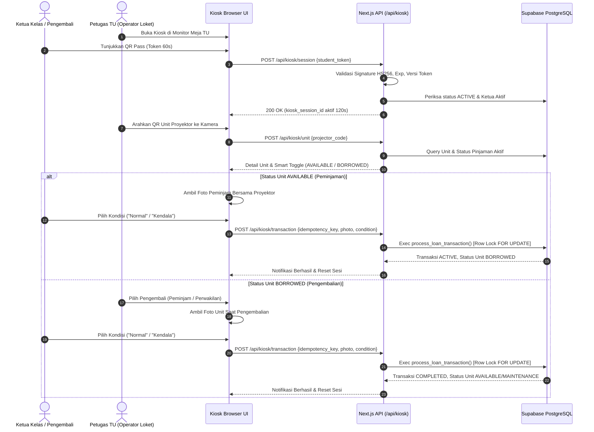

# Product Requirements Document (PRD) — PINJAM (SmartProjex)
## Versi 1.0.0 (Release Baseline)

> **Dokumen Sumber Kebenaran (*Single Source of Truth*)**:  
> Dokumen ini memuat spesifikasi persyaratan produk, arsitektur sistem, aturan bisnis, skema basis data, dan kriteria penerimaan resmi untuk aplikasi **PINJAM (SmartProjex)** versi **v1.0.0**. Seluruh implementasi kode sumber pada branch `main` (commit `c5449e2`) dan tag `v1.0.0` mengacu secara otoritatif pada dokumen ini.

---

## BAB I — PENDAHULUAN

### 1.1 Latar Belakang
Pada lingkungan perguruan tinggi (khususnya Fakultas Matematika dan Ilmu Pengetahuan Alam, Universitas Negeri Medan / FMIPA UNIMED), perkuliahan tatap muka sangat bergantung pada penggunaan perangkat proyektor LCD bergerak (*portable projectors*). Selama ini, operasional peminjaman dan pengembalian unit proyektor dilakukan secara konvensional di meja loket Tata Usaha (TU). Ketua kelas atau perwakilan kelas harus hadir secara fisik, mengantre, mengisi buku besar peminjaman berbahan kertas, membubuhkan tanda tangan manual, dan menyerahkan Kartu Tanda Penduduk (KTP) asli sebagai jaminan fisik (*collateral*).

Metode manual ini menimbulkan serangkaian permasalahan struktural:
1. **Antrean Panjang di Jam Sibuk**: Terjadi penumpukan mahasiswa di meja loket TU 15–30 menit sebelum jadwal perkuliahan dimulai, yang sering kali menunda dimulainya perkuliahan.
2. **Risiko Kehilangan dan Kerusakan Dokumen Fisik**: Penitipan kartu identitas asli (KTP/KTM) berisiko tinggi terhadap tertukarnya identitas, tercecer, atau hilang di meja loket.
3. **Ketidakakuratan Pencatatan dan Visibilitas Inventaris yang Rendah**: Buku besar kertas rentan terhadap tulisan tangan yang sulit dibaca, catatan jam pinjam yang tidak presisi, dan ketiadaan visibilitas status unit secara *real-time* (apakah proyektor sedang tersedia, dipinjam, atau dalam perbaikan).
4. **Ketiadaan Bukti Kondisi Fisik Transaksional**: Ketika terjadi kerusakan komponen proyektor (seperti port HDMI/VGA longgar, kabel putus, atau lensa buram), staf TU kesulitan menelusuri penanggung jawab karena serah terima sebelumnya tidak disertai bukti dokumentasi visual yang objektif.

Aplikasi **PINJAM (SmartProjex)** dikembangkan untuk mentransformasi total tata kelola peminjaman proyektor kampus menjadi ekosistem digital berbasis web yang cepat, nir-sentuh KTP fisik (*zero physical collateral*), aman, dan terverifikasi melalui teknologi *dual-scan* (QR Pass mahasiswa dan QR aset unit), dokumentasi foto kamera langsung, konfirmasi kondisi satu langkah, serta transaksi atomik database.

### 1.2 Identifikasi Masalah
Berdasarkan observasi lapangan dan wawancara dengan staf loket TU dan perwakilan mahasiswa, masalah utama dirumuskan sebagai berikut:
1. Waktu pencatatan transaksi manual memakan durasi 2 hingga 3 menit per peminjaman, menciptakan kemacetan layanan.
2. Belum ada mekanisme pengikatan identitas digital yang aman sebagai pengganti penitipan kartu fisik KTP.
3. Ketiadaan basis data mahasiswa terpusat yang dapat diakses langsung oleh pengembang lokal (ketiadaan akses API SIAKAD/PDDikti).
4. Status penerbitan Kartu Tanda Mahasiswa (KTM) yang belum merata bagi seluruh angkatan mahasiswa UNIMED.
5. Rentannya pencatatan transaksi terhadap manipulasi waktu pengembalian (*timestamp fraud*) dan klaim palsu ketua kelas.

### 1.3 Rumusan Masalah
Bagaimana merancang dan membangun sistem informasi peminjaman dan pengelolaan inventaris proyektor berbasis web responsif yang:
1. Mampu memvalidasi kelayakan peminjam (ketua kelas aktif) secara mandiri dan aman tanpa integrasi API eksternal?
2. Mampu mengeksekusi transaksi serah terima peminjaman dan pengembalian dalam waktu singkat (target ≤ 15 detik) menggunakan *dual-scan* QR dan kamera tunggal laptop meja loket?
3. Mampu menggantikan fungsi jaminan KTP fisik dengan pelacakan batas waktu pengembalian otomatis (*due_at*) dan dokumentasi foto kondisi fisik unit?
4. Mampu menjamin integritas transaksi tinggi (maksimal 1 pinjaman aktif per proyektor dan per mahasiswa) tanpa celah *race condition* atau pengiriman ganda?

### 1.4 Tujuan Pengembangan
1. **T-01**: Memangkas waktu operasional serah terima proyektor dari 120–180 detik menjadi rata-rata ≤ 15 detik untuk transaksi normal.
2. **T-02**: Menghilangkan 100% praktik penitipan kartu identitas fisik (KTP/KTM) di meja loket TU.
3. **T-03**: Menyediakan pemantauan ketersediaan unit inventaris proyektor dan pelacakan keterlambatan secara *real-time*.
4. **T-04**: Merekam jejak audit digital dan dokumentasi foto setiap serah terima unit proyektor.
5. **T-05**: Menegakkan aturan otorisasi bahwa peminjam utama adalah ketua kelas aktif yang terverifikasi pada semester berjalan.

### 1.5 Manfaat Sistem
- **Bagi Mahasiswa (Ketua Kelas)**: Memperoleh kepastian layanan cepat, tidak perlu menyerahkan KTP fisik, dan memiliki QR Pass digital dinamis yang aman dari pemalsuan screenshot.
- **Bagi Petugas Tata Usaha (TU)**: Menghilangkan beban penulisan buku besar manual, mempermudah pelacakan aset unit yang sedang dibawa atau terlambat, dan memiliki bukti foto dokumentasi visual yang objektif jika terjadi komplain kendala unit.
- **Bagi Pimpinan Fakultas / Jurusan**: Memperoleh transparansi data utilisasi aset perkuliahan, riwayat kerusakan unit, dan laporan audit log operasional yang dapat diekspor secara berkala.

### 1.6 Ruang Lingkup
Ruang lingkup sistem PINJAM versi v1.0.0 meliputi:
- Pendaftaran mandiri mahasiswa dan pemilihan rombel dari daftar kelas baku.
- Verifikasi foto wajah mandiri dengan panduan deteksi visual (*framing guide*) dan pemotretan dokumen KTM/KTP via kamera perangkat.
- Pemeriksaan administratif manual oleh staf TU (pencocokan visual wajah, nama, dan kelayakan ketua kelas) dengan penghapusan instan foto dokumen pascakeputusan.
- Penerbitan QR Pass dinamis berbasis token bertanda tangan kriptografis (HS256) berumur 60 detik.
- Halaman loket meja layanan (*Dual-Scan Kiosk*) mandiri dengan dukungan mode layar penuh (Fullscreen API) dan monitor kedua.
- Pemrosesan transaksi cerdas (*Smart Toggle*) yang menentukan aksi peminjaman atau pengembalian secara otomatis dari status unit proyektor di sisi server.
- Pengambilan foto dokumentasi serah terima transaksi dan konfirmasi kondisi satu langkah ("Normal" vs "Laporkan Kendala").
- Jalur cadangan (*fallback*) pencarian manual identitas peminjam jika perangkat mahasiswa bermasalah.
- Panel Dashboard Admin untuk buku besar digital, pelacakan keterlambatan, manajemen status unit inventaris, pengelolaan rombel kelas/semester, manajemen akun staf, dan ekspor riwayat transaksi ke CSV.
- Mekanisme tugas terjadwal (*scheduled retention cron*) untuk menjaga kepatuhan privasi data dan pembersihan otomatis foto kedaluwarsa.

### 1.7 Batasan Sistem
1. Sistem beroperasi sebagai aplikasi web responsif (desktop browser dan mobile browser); tidak disediakan aplikasi native Android/iOS.
2. Sistem tidak terhubung langsung ke basis data induk universitas (SIAKAD / PDDikti) karena keterbatasan izin akses jaringan kampus.
3. Sistem mengandalkan satu kamera webcam laptop pada meja loket TU untuk membaca QR dan mengambil foto dokumentasi.
4. Sistem tidak menjalankan inferensi biometrik otomatis (*facial recognition matching*) maupun OCR; seluruh keputusan verifikasi dilakukan secara manual oleh staf manusia (*human-in-the-loop*).
5. Default batas waktu pengembalian (`due_at`) adalah akhir jam kerja operasional loket TU pada hari peminjaman (dapat disesuaikan oleh administrator).

---

## BAB II — GAMBARAN UMUM PRODUK

### 2.1 Deskripsi Produk
**PINJAM (SmartProjex)** adalah sistem informasi berbasis web yang memadukan teknologi web modern (Next.js 15 App Router, React 19, TypeScript, dan Tailwind CSS) dengan backend serverless Supabase (PostgreSQL, Supabase Auth, dan Supabase Storage) yang di-host pada platform Vercel. Sistem dirancang untuk melayani dua antarmuka utama:
1. **Mobile Portal Mahasiswa**: Digunakan oleh mahasiswa untuk registrasi mandiri, mengunggah foto verifikasi langsung via kamera, melihat status verifikasi, menampilkan QR Pass dinamis berumur 60 detik, mencabut QR secara mandiri, dan mengalihkan kepemimpinan kelas.
2. **Kiosk & Dashboard Administrasi**: Digunakan oleh staf TU dan Administrator di meja layanan untuk memindai QR, mengambil foto serah terima unit, memantau buku besar digital, mengelola rombel dan semester, serta mengelola siklus hidup aset proyektor.

### 2.2 Visi dan Tujuan Produk
Mewujudkan tata kelola logistik perlengkapan perkuliahan yang modern, transparan, akuntabel, dan mengutamakan perlindungan data pribadi (*privacy by design*) di lingkungan pendidikan tinggi.

### 2.3 Target Pengguna
- **Ketua Kelas Mahasiswa**: Mahasiswa aktif yang dipilih/ditugaskan sebagai perwakilan rombongan belajar perkuliahan.
- **Rekan Mahasiswa (Perwakilan)**: Mahasiswa aktif satu rombel yang ditugaskan mengembalikan unit proyektor atas nama ketua kelas.
- **Petugas Tata Usaha (Operator Loket / `STAFF`)**: Tenaga kependidikan yang bertugas menjaga loket proyektor dan melayani transaksi harian.
- **Administrator Sistem (`ADMIN`)**: Kepala TU atau pengelola IT fakultas/jurusan yang memiliki wewenang penuh atas konfigurasi sistem.

### 2.4 Stakeholder
- **Pimpinan Fakultas/Jurusan**: Dekan, Wakil Dekan Bidang Keuangan dan Umum, Ketua Jurusan.
- **Staf Tata Usaha / Perlengkapan**: Pelaksana operasional harian meja layanan.
- **Dosen Pengampu**: Pengguna akhir fasilitas proyektor di ruang kuliah.
- **Mahasiswa**: Peminjam proyektor untuk kegiatan presentasi dan pembelajaran.

### 2.5 User Roles & Matriks Hak Akses

Sistem membedakan tiga peran pengguna secara tegas di sisi server (Server-Side Role Guard & Layout Guards):

| Aksi / Fungsi Sistem | Mahasiswa (`ACTIVE`) | Petugas TU (`STAFF`) | Administrator (`ADMIN`) |
|---|:---:|:---:|:---:|
| Registrasi mandiri & verifikasi email | ✔ | – | – |
| Mengambil foto wajah & KTM/KTP via kamera perangkat | ✔ | – | – |
| Melihat QR Pass dinamis sendiri (jika ketua aktif) | ✔ | – | – |
| Mencabut QR Pass sendiri (*instant revoke*) | ✔ | – | – |
| Mengalihkan kepemimpinan kelas ke rekan sekelas | ✔ | – | – |
| Mengajukan klaim ketua kelas semester baru | ✔ | – | – |
| Membuka dan mengoperasikan antarmuka Kiosk Loket | – | ✔ | ✔ |
| Melakukan pencarian manual peminjam di Kiosk | – | ✔ | ✔ |
| Memeriksa antrean verifikasi pendaftar & memutuskan | – | ✔ | ✔ |
| Memutuskan permohonan klaim ketua kelas | – | ✔ | ✔ |
| Melihat foto referensi & foto transaksi via Signed URL | – | ✔ | ✔ |
| Mengubah status unit (`MAINTENANCE` ↔ `AVAILABLE`) | – | ✔ | ✔ |
| Menambah, mengedit, menonaktifkan unit proyektor | – | – | ✔ |
| Mencetak stiker lembar QR aset proyektor | – | – | ✔ |
| Mengelola kelas baku, semester, dan salin kelas (*copy term*) | – | – | ✔ |
| Melepas jabatan ketua kelas secara paksa | – | – | ✔ |
| Mengelola akun petugas (tambah/edit/nonaktifkan staf) | – | – | ✔ |
| Melihat jejak audit lengkap (*audit logs*) & ekspor CSV | – | – | ✔ |

### 2.6 Product Scope (Batasan In-Scope v1.0.0)
- Registrasi mandiri mahasiswa dengan pilihan rombel baku.
- Panduan visual penempatan wajah (*face framing detection*) tanpa biometrik.
- Pemotretan fisik dokumen identitas (KTM atau KTP, perlakuan setara) langsung dari kamera tanpa unggah berkas galeri.
- Verifikasi manual 3 centang oleh petugas TU dan penghapusan permanen dokumen identitas segera setelah keputusan.
- Token QR Pass 60 detik bertanda tangan HMAC-SHA256 tanpa menyertakan NIM di payload.
- Dual-scan Kiosk dengan siklus kamera webcam persisten dan kontrol Fullscreen API.
- Smart Toggle transaksi atomik (peminjaman vs pengembalian ditentukan server).
- Dokumentasi foto serah terima unit proyektor.
- Konfirmasi kondisi satu langkah (Normal vs Laporkan Kendala).
- Pengembalian unit oleh peminjam langsung maupun perwakilan.
- Jalur cadangan pencarian manual ketua kelas berfoto referensi.
- Dashboard buku besar digital dengan metrik inventaris realtime dan filter keterlambatan.
- Manajemen rombel kelas baku dan semester akademik.
- Manajemen akun staf individual meja layanan TU.
- Tugas pembersihan data terjadwal (*retention cron*).

### 2.7 Out of Scope (Dilarang Dikerjakan pada v1.0.0)
- Integrasi daring ke API SIAKAD / PDDikti universitas.
- Algoritma pencocokan wajah otomatis (*Facial Recognition Matching*) atau inferensi biometrik.
- Optical Character Recognition (OCR) otomatis pada dokumen identitas (KTP/KTM).
- Penyimpanan Nomor Induk Kependudukan (NIK) mahasiswa di basis data.
- Aplikasi native mobile iOS/Android (seluruhnya diakses via Web Responsif).
- Sistem pemesanan / reservasi unit proyektor jauh-jauh hari (*advance booking*).
- Gerbang pembayaran denda keterlambatan daring (*online payment gateway*).
- Penjatuhan sanksi akademik atau denda otomatis oleh sistem.
- Serah terima langsung unit antar-kelas tanpa melalui meja loket Kiosk.
- Peminjaman lebih dari satu unit proyektor secara simultan oleh satu ketua kelas.
- Peminjaman unit proyektor oleh mahasiswa yang bukan ketua kelas aktif.

---

## BAB III — KEBUTUHAN FUNGSIONAL

### FT-00 — Registrasi Mandiri, Verifikasi Kamera & Keputusan Admin
- **Status Implementasi**: `IMPLEMENTED` (Dibuktikan oleh `src/app/(student)/register/page.tsx`, `src/components/registration/*`, `src/lib/face-detection.ts`, `src/app/api/students/profile/route.ts`, `src/app/api/students/me/verification-photos/route.ts`, `src/app/admin/verifications/page.tsx`, `src/components/admin/VerificationCapture.tsx`, dan `src/app/api/admin/verifications/*`).
- **Batasan Pengujian Aktual**: Logika antarmuka kamera, framing deteksi wajah, dan penghapusan dokumen telah teruji 100% pada level unit test dan integrasi staging API. Pengujian operasional tatap muka mahasiswa nyata di loket TU akan dilaksanakan pada fase pilot kampus.
- **Deskripsi**: Alur pendaftaran mandiri mahasiswa yang menggabungkan pengisian identitas profil, verifikasi email institusi/pribadi, pengambilan foto wajah mandiri dengan panduan framing visual, pemotretan dokumen identitas (KTM/KTP) secara langsung via kamera, ringkasan pra-kirim, serta evaluasi manual oleh staf TU.
- **Rincian Fungsional**:
  1. Mahasiswa menginput Nama Lengkap, NIM, Email, Kata Sandi, memilih rombel dari daftar kelas baku, dan menyetujui pernyataan persetujuan privasi data. Akun dibuat di Supabase Auth berstatus `UNVERIFIED_EMAIL`.
  2. Konfirmasi email dikirimkan oleh Supabase Auth. Setelah diklik, status berubah menjadi `PENDING_DOCUMENT`.
  3. Mahasiswa menyalakan kamera depan/belakang perangkat. Sistem menjalankan deteksi wajah (*face detection*) berbasis pustaka ringan semata-mata untuk memandu posisi wajah (tengah oval panduan dan jarak ideal). **Dilarang keras menggunakan biometrik otomatis atau pengenalan identitas**. Seluruh pratinjau kamera dan hasil tangkapan wajib diproses secara normal tanpa efek mirror (`scaleX(-1)` dilarang).
  4. Mahasiswa memotret fisik kartu KTM atau KTP secara langsung via kamera perangkat dengan bantuan kotak panduan kartu (dilarang unggah dari galeri; sistem tidak menjalankan OCR dan tidak menyimpan NIK).
  5. Mahasiswa memeriksa ringkasan data diri dan kedua foto pada tahap Review. Setelah dikirimkan, status permohonan menjadi `PENDING_REVIEW`.
  6. Staf TU memeriksa antrean verifikasi di `/admin/verifications`, melihat foto wajah dan foto dokumen berdampingan (*side-by-side*), serta mencentang 3 checklist manual wajib:
     - `face_match`: Kesesuaian visual wajah mahasiswa pada foto dengan foto pada dokumen identitas.
     - `name_match`: Kesesuaian nama pada dokumen identitas dengan nama terdaftar.
     - `status_confirmed`: Kesesuaian kelas dan konfirmasi keabsahan mahasiswa sebagai ketua kelas.
  7. Keputusan Petugas:
     - `APPROVE`: Status mahasiswa menjadi `ACTIVE`. Klaim ketua awal (`INITIAL`) otomatis disetujui jika kelas belum memiliki ketua.
     - `REJECT`: Status menjadi `REJECTED`, mewajibkan pengisian catatan alasan penolakan.
     - `REQUEST_RESUBMISSION`: Status menjadi `RESUBMISSION_REQUIRED`, mewajibkan catatan instruksi perbaikan agar mahasiswa dapat memotret ulang dari portalnya.
  8. **Penghapusan Instan Foto Dokumen**: Pada ketiga jenis keputusan di atas, berkas foto dokumen kartu identitas dihapus secara permanen dari Supabase Storage seketika itu juga. Foto wajah referensi disimpan selama akun aktif sebagai pembanding visual manual di meja loket.

### FT-01 — QR Pass Mahasiswa & Pengelolaan Jabatan Ketua
- **Status Implementasi**: `IMPLEMENTED` (Dibuktikan oleh `src/app/(student)/my-qr/page.tsx`, `src/lib/qr-token.ts`, `src/app/api/students/me/qr/route.ts`, `src/app/api/students/me/qr/revoke/route.ts`, `src/app/api/students/me/leader/transfer/route.ts`, dan `src/components/student/ClaimClassModal.tsx`).
- **Deskripsi**: Antarmuka mobile untuk ketua kelas aktif yang menampilkan QR Pass dinamis berumur singkat dan fitur manajemen peran ketua kelas.
- **Rincian Fungsional**:
  1. Halaman `/my-qr` hanya dapat diakses oleh akun mahasiswa berstatus `ACTIVE` yang sedang menjabat sebagai ketua kelas aktif pada semester berjalan (`classes.leader_student_id = student.id`).
  2. QR Pass memuat token JSON Web Signature (JWS) bertanda tangan HMAC-SHA256 (`HS256`) dengan masa berlaku 60 detik (`exp`). Token diperbarui otomatis di layar ponsel setiap 45 detik.
  3. Payload token hanya memuat ID mahasiswa (`sub`), versi token (`v`), dan waktu kedaluwarsa (`exp`). **Dilarang mencantumkan NIM mahasiswa pada payload token QR**.
  4. Antarmuka menampilkan Nama Lengkap, NIM, Program Studi, Angkatan, Rombel, hitung mundur masa berlaku token, instruksi menaikkan kecerahan layar, serta ketiadaan tombol unduh QR untuk mencegah pembagian screenshot.
  5. Fitur **Cabut QR**: Mahasiswa dapat menekan tombol "Cabut QR", yang akan menaikkan nilai `students.qr_token_version` di database secara instan (`POST /api/students/me/qr/revoke`), sehingga token sebelumnya seketika tidak berlaku di server.
  6. Fitur **Alihkan Jabatan (*Transfer Leader*)**: Ketua kelas aktif dapat mengalihkan jabatan ketua kepada rekan sekelasnya yang telah berstatus `ACTIVE` dalam rombel yang sama melalui modal konfirmasi eksplisit (`POST /api/students/me/leader/transfer`). Operasi berlangsung secara atomik (1-langkah langsung), mencabut QR ketua lama seketika, menetapkan ketua baru, dan mencatat audit log `LEADER_TRANSFERRED`.

### FT-02 — Dual-Scan Kiosk Meja Layanan TU
- **Status Implementasi**: `IMPLEMENTED` (Dibuktikan oleh `src/app/kiosk/page.tsx`, `src/components/kiosk/QrScannerBox.tsx`, `src/lib/kiosk-workflow.ts`, `src/app/api/kiosk/session/route.ts`, `src/app/api/kiosk/unit/route.ts`, `src/app/api/kiosk/transaction/route.ts`, dan `src/app/api/kiosk/students/search/route.ts`).
- **Batasan Pengujian Aktual**: Logika pemindaian dual-scan, state machine Kiosk, Smart Toggle, idempotensi, dan mutasi status basis data teruji 100% pada level unit test dan integrasi staging API. Pengujian perangkat keras webcam laptop fisik dan proyektor fisik sesungguhnya di loket kampus dijadwalkan pada fase pilot operasional.
- **Deskripsi**: Antarmuka Kiosk mandiri yang dioperasikan staf loket TU pada tab terpisah dan layar penuh untuk melayani transaksi serah terima peminjaman dan pengembalian unit proyektor secara cepat.
- **Rincian Fungsional**:
  1. Dibuka dari tombol "Buka Kiosk" pada dashboard admin ke tab baru (`target="_blank"`, `rel="noopener noreferrer"`) agar dashboard pemantauan admin tetap aktif di tab utama dan Kiosk dapat digeser ke monitor kedua.
  2. Mendukung kontrol Layar Penuh (*Fullscreen API*) dengan fallback penanganan peramban dan beroperasi mandiri tanpa memuat navigasi atau menu admin.
  3. Menjalankan pemindaian terus-menerus (*continuous scan*) menggunakan siklus kamera webcam laptop yang persisten tanpa memuat ulang (*reload*) komponen kamera.
  4. **Pemindaian QR Ganda (*Dual-Scan*)**:
     - Langkah 1: Memindai QR Pass mahasiswa. Server memverifikasi signature HS256, expiration, keaktifan akun (`ACTIVE`), status ketua aktif, dan kesesuaian versi token. Server menerbitkan `kiosk_session_id` berumur 120 detik.
     - Langkah 2: Memindai QR fisik unit proyektor. Server membaca status unit dari basis data.
  5. **Smart Toggle Transaksi**:
     - Jika unit `AVAILABLE`: Sistem menjalankan alur **Peminjaman**. Menampilkan identitas ketua kelas, rombel, unit proyektor, dan estimasi waktu kembali (`due_at`).
     - Jika unit `BORROWED`: Sistem menjalankan alur **Pengembalian**. Menampilkan peminjam aktif, batas waktu, penanda terlambat (*overdue*), dan meminta identitas pengembali (Peminjam Sendiri via scan QR atau Perwakilan dengan pencatatan nama oleh petugas).
  6. **Dokumentasi Foto & Konfirmasi Kondisi**:
     - Mengambil foto dokumentasi serah terima via webcam dengan hitung mundur 3 detik dan pratinjau ulang. Foto pinjam memperlihatkan peminjam bersama unit; foto kembali memperlihatkan fisik unit dan pengembali.
     - Menampilkan konfirmasi satu langkah dengan dua pilihan visual setara:
       - **"Kondisi terlihat normal"**: Menyimpan transaksi `ACTIVE` (peminjaman) atau `COMPLETED` (pengembalian).
       - **"Laporkan kendala"**: Jika saat meminjam, transaksi dibatalkan dan unit menjadi `MAINTENANCE`. Jika saat mengembalikan, transaksi menjadi `COMPLETED` dengan `return_condition = 'REPORTED_ISSUE'` dan unit menjadi `MAINTENANCE`.
  7. **Jalur Cadangan (*Manual Lookup*)**: Jika HP mahasiswa mati atau QR gagal dipindai, petugas dapat mencari ketua kelas aktif berdasarkan Nama/NIM, membandingkan wajah fisik dengan foto referensi akun di layar, dan mencatat alasan identifikasi manual (`identification_method = 'MANUAL_LOOKUP'`).
  8. **Proteksi Idempotensi**: Setiap pengiriman transaksi menyertakan `idempotency_key` acak berbasis UUID/kriptografis di sisi klien untuk mencegah transaksi ganda akibat klik ganda atau gangguan jaringan.

### FT-03 — Buku Besar Digital, Inventaris & Keterlambatan
- **Status Implementasi**: `IMPLEMENTED` (Dibuktikan oleh `src/app/admin/page.tsx`, `src/components/admin/AdminDashboardView.tsx`, `src/components/admin/ProjectorsInventoryView.tsx`, `src/app/admin/projectors/page.tsx`, `src/app/api/admin/loans/route.ts`, `src/app/api/admin/export/loans/route.ts`, `src/app/api/admin/projectors/*`, `src/app/api/admin/photos/sign/route.ts`, dan `src/components/admin/AuditLogsView.tsx`).
- **Deskripsi**: Pusat pemantauan dan pengelolaan operasional TU untuk menggantikan buku besar kertas dan mengelola inventaris proyektor kampus.
- **Rincian Fungsional**:
  1. Kartu Ringkasan Metrik Realtime: Menampilkan 5 metrik inventaris: Total Unit, Unit Tersedia (`AVAILABLE`), Sedang Dipinjam (`BORROWED`), Terlambat (*Overdue*), dan Dalam Perawatan (`MAINTENANCE`).
  2. Pemantauan Keterlambatan: Daftar khusus transaksi aktif yang melewati `due_at` dengan penanda visual keterlambatan.
  3. Tabel Riwayat Peminjaman Lengkap: Kolom waktu ambil, batas waktu, waktu kembali, identitas peminjam, kelas, kode/nama unit, foto referensi, foto ambil, foto kembali, identitas pengembali, petugas yang memproses, dan status transaksi.
  4. Penampil Foto Aman: Foto dokumentasi dan foto referensi dibuka melalui *Signed URL* privat berdurasi maksimal 60 detik (`POST /api/admin/photos/sign`). Setiap pembukaan foto dicatat secara otomatis ke dalam tabel `audit_logs`.
  5. Manajemen Inventaris Proyektor: Administrator dapat menambah unit baru, mengubah nama/catatan/nomor seri, menonaktifkan unit (`INACTIVE`), dan mencetak lembar QR aset unik per unit. Petugas TU dapat memperbarui status unit ke `MAINTENANCE` atau `AVAILABLE` dengan catatan alasan wajib.
  6. Ekspor Laporan CSV: Administrator dapat mengekspor riwayat transaksi terfilter rentang tanggal ke dalam format berkas CSV (`GET /api/admin/export/loans`).

### FT-04 — Manajemen Rombel Kelas, Semester & Klaim Ketua
- **Status Implementasi**: `IMPLEMENTED` (Dibuktikan oleh `src/app/admin/classes/page.tsx`, `src/components/admin/LeaderClaimsInboxView.tsx`, `src/app/api/admin/classes/route.ts`, `src/app/api/admin/classes/copy-term/route.ts`, `src/app/api/admin/leader-claims/route.ts`, dan `src/app/api/admin/leader-claims/[id]/route.ts`).
- **Deskripsi**: Modul pengelolaan struktur kelas baku, semester akademik, evaluasi klaim kepemimpinan, dan transisi rombel.
- **Rincian Fungsional**:
  1. Pengelolaan Kelas Baku: Administrator membuat kombinasi rombel resmi (Program Studi, Tahun Angkatan, Kode Rombel, Semester Akademik). Pendaftaran mahasiswa wajib memilih dari daftar kelas ini; tidak ada masukan teks bebas (*no free-text class input*).
  2. Salin Kelas Antar-Semester (*Copy Term*): Administrator dapat menduplikasi seluruh struktur kelas dari semester aktif ke semester baru secara massal tanpa menyertakan ketua kelas lama (`POST /api/admin/classes/copy-term`).
  3. Antrean Klaim Ketua Kelas (*Leader Claims Inbox*):
     - Menampilkan seluruh permohonan klaim dengan rincian tipe: `INITIAL` (calon ketua pendaftar pertama), `REPLACEMENT` (pendaftar pada kelas yang sudah berketua), dan `TRANSFER` (pengalihan jabatan mandiri).
     - Administrator dapat menyetujui (`APPROVED`) atau menolak (`REJECTED`) klaim dengan catatan alasan. Persetujuan klaim otomatis memperbarui `classes.leader_student_id` dan mencabut QR ketua lama.
  4. Pelepasan Ketua Kelas Manual: Administrator memiliki wewenang untuk mencopot jabatan ketua kelas aktif sewaktu-waktu dengan alasan administratif yang tercatat pada audit log.

---

## BAB IV — KEBUTUHAN NONFUNGSIONAL

| Parameter | Kebutuhan & Spesifikasi Terverifikasi | Status Implementasi |
|---|---|:---:|
| **NFR-01: Performa** | Pembacaan token QR Pass di Kiosk hingga pengambilan frame kamera berlangsung dalam waktu responsif (< 1 detik pada hardware loket standar). Transaksi normal tuntas ≤ 15 detik. | `IMPLEMENTED` |
| **NFR-02: Penyimpanan** | Kompresi gambar sisi klien sebelum pengiriman (maksimal ukuran berkas target ≤ 250 KB per foto) dengan format JPEG/WebP kualitas memadai untuk identifikasi visual proyektor dan wajah. | `IMPLEMENTED` |
| **NFR-03: Keamanan & Multi-Role** | Proteksi sesi di sisi server. Akun petugas individual (dilarang akun bersama). Penegakan Server Layout Guards terpisah antara Mahasiswa (`/(student)`), Kiosk (`/kiosk`), dan Admin (`/admin`). Pengujian simultan wajib menggunakan profil browser berbeda. | `IMPLEMENTED` |
| **NFR-04: Kompatibilitas** | Antarmuka QR Pass dan registrasi foto responsif penuh di browser mobile (Chrome Android dan Safari iOS). Antarmuka Kiosk dan Dashboard optimal di resolusi desktop/laptop loket (1366x768 ke atas) serta mendukung monitor kedua. | `IMPLEMENTED` |
| **NFR-05: Privasi & Integritas Gambar** | Pernyataan persetujuan privasi eksplisit sebelum pemotretan. Pemotretan langsung via kamera (dilarang unggah berkas galeri). **Dilarang efek mirror / pembalikan horizontal (`scaleX(-1)`)** pada seluruh kanvas dan tangkapan. Deteksi wajah murni sebagai panduan framing visual, tanpa pencocokan biometrik otomatis. | `IMPLEMENTED` |
| **NFR-06: Integritas Data** | Seluruh mutasi peminjaman/pengembalian dieksekusi secara atomik dalam fungsi PL/pgSQL `process_loan_transaction` dengan *row-level locking* (`FOR UPDATE`). Penegakan partial unique index: maksimal 1 pinjaman aktif per proyektor dan per mahasiswa. Proteksi idempotency key pada transaksi. | `IMPLEMENTED` |
| **NFR-07: Keamanan Penyimpanan** | Berkas foto wajah referensi dan foto transaksi disimpan dalam bucket privat Supabase Storage (`smartprojex-media`). Akses dibatasi RLS Storage dan hanya dapat dilihat melalui *Signed URL* berdurasi pendek (maksimal 60 detik). Setiap penerbitan Signed URL dicatat di `audit_logs`. | `IMPLEMENTED` |
| **NFR-08: Retensi Data** | Penghapusan permanen dokumen kartu identitas (KTM/KTP) segera setelah keputusan verifikasi admin. Foto wajah referensi disimpan selama akun berstatus `ACTIVE` dan dihapus 90 hari setelah akun dinonaktifkan (`INACTIVE`). Foto transaksi normal dihapus 180 hari setelah selesai via Vercel Cron harian. | `IMPLEMENTED` |
| **NFR-09: Keandalan Verifikasi** | Foto dokumen yang buram tidak otomatis menggagalkan akun; petugas dapat meminta perbaikan (*Request Resubmission*) dengan instruksi atau memeriksa fisik dokumen secara langsung di loket. | `IMPLEMENTED` |
| **NFR-10: Ketersediaan & Cadangan** | Ekspor riwayat transaksi ke CSV dapat dilakukan administrator kapan saja. Tugas Vercel Cron harian menjaga proyek Supabase free-tier tetap aktif (*keep-alive*). Prosedur cadangan buku besar manual disiapkan saat internet padam dan dapat diinput belakangan. | `IMPLEMENTED` |
| **NFR-11: Penanganan Waktu** | Seluruh kolom timestamp disimpan dengan tipe `timestamptz` di PostgreSQL. Sumber waktu transaksi berasal dari server basis data. Seluruh tampilan antarmuka diseragamkan dalam Waktu Indonesia Barat (`Asia/Jakarta` / WIB). | `IMPLEMENTED` |

---

## BAB V — ATURAN BISNIS (BUSINESS RULES)

1. **Aturan Hak Peminjaman (BR-01)**:
   Hanya mahasiswa yang memenuhi tiga syarat kumulatif yang dapat meminjam proyektor: (1) Akun berstatus `ACTIVE`, (2) Email terverifikasi, dan (3) Menjabat sebagai ketua kelas aktif pada semester berjalan (`classes.leader_student_id = student.id`).
2. **Aturan Batas Pinjaman Aktif (BR-02)**:
   Satu ketua kelas hanya diperbolehkan meminjam maksimal **1 unit proyektor** pada satu waktu. Sistem menolak peminjaman baru jika ketua kelas masih memiliki transaksi berstatus `ACTIVE`.
3. **Aturan Status Unit Proyektor (BR-03)**:
   Satu unit proyektor hanya dapat dipinjam jika berstatus `AVAILABLE`. Unit berstatus `BORROWED`, `MAINTENANCE`, atau `INACTIVE` ditolak oleh sistem untuk peminjaman baru.
4. **Aturan Batas Waktu Pengembalian (BR-04)**:
   Setiap peminjaman memiliki batas waktu pengembalian (`due_at`) yang secara baku ditentukan oleh akhir jam operasional meja TU pada hari peminjaman (diambil dari `app_settings.operational_hours`), kecuali diatur khusus oleh administrator.
5. **Aturan Pengembalian Fleksibel (BR-05)**:
   Pengembalian proyektor dapat dilakukan oleh ketua kelas sendiri (memindai QR Pass) atau oleh rekan mahasiswa perwakilan satu kelas. Jika dilakukan oleh perwakilan, staf TU wajib mencatat nama lengkap perwakilan pada sistem.
6. **Aturan Penetapan Ketua Kelas Pertama (BR-06)**:
   Pendaftar pertama yang memilih rombel kelas yang belum memiliki ketua akan menghasilkan klaim berjenis `INITIAL` dengan status `PENDING`. Klaim ini otomatis disetujui saat staf TU menyetujui verifikasi pendaftaran mahasiswa bersangkutan.
7. **Aturan Pergantian & Transfer Ketua (BR-07)**:
   Pendaftar pada kelas yang sudah memiliki ketua menghasilkan klaim berjenis `REPLACEMENT` yang wajib dievaluasi terpisah oleh administrator. Pengalihan mandiri oleh ketua aktif (`TRANSFER`) hanya dapat diarahkan kepada mahasiswa berstatus `ACTIVE` dalam rombel yang sama dan langsung berlaku seketika (*instant revocation* QR lama).
8. **Aturan Masa Berlaku Semester (BR-08)**:
   Jabatan ketua kelas berlaku selama satu semester akademik berjalan. Pada pergantian semester baru, seluruh jabatan ketua kelas kedaluwarsa secara otomatis dan mahasiswa aktif mengajukan klaim rombel baru tanpa perlu memotret ulang dokumen identitas.
9. **Aturan Penanganan Kerusakan Unit (BR-09)**:
   Jika peminjam atau pengembali memilih opsi "Laporkan kendala", unit otomatis berubah status menjadi `MAINTENANCE`. Sistem tidak menjatuhkan sanksi atau denda moneter secara otomatis; keputusan tanggung jawab diselesaikan oleh pihak kampus di luar sistem berdasarkan bukti foto dokumentasi.
10. **Aturan Jalur Cadangan Loket (BR-10)**:
    Jika ketua kelas tidak dapat menampilkan QR Pass (ponsel kehabisan daya, kendala sinyal, atau layar retak), staf loket diperbolehkan melakukan pencarian manual (*Manual Lookup*) dengan syarat wajib mencocokkan wajah peminjam dengan foto referensi di layar dan mencatat alasan pencarian manual.

---

## BAB VI — ARSITEKTUR SISTEM

### 6.1 Komponen Arsitektur Teknologi
- **Frontend Layer**: Next.js 15 (App Router), React 19, TypeScript (Strict Mode), Tailwind CSS, Headless UI / Lucide React icons.
- **API & Backend Layer**: Next.js Server Route Handlers (Edge & Node.js Serverless runtime di Vercel), Zod Schema Validation, Jose Library (HMAC-SHA256 Token Signing).
- **Database & Auth Layer**: Supabase Managed PostgreSQL dengan Row Level Security (RLS), Supabase Auth (GoTrue), Supabase Storage Bucket.
- **Hosting & Infrastructure**: Vercel Platform (Deployment, Serverless Execution, Vercel Cron).

### 6.2 Diagram Arsitektur Komponen

```mermaid
flowchart TD
    subgraph ClientLayer["Frontend Client Layer"]
        MobileClient["Mobile Web (Mahasiswa)\n- Register & Camera Capture\n- Dynamic QR Pass (60s)"]
        KioskClient["Kiosk Meja Loket (TU)\n- Dual-Scan Camera\n- Transaction Capture"]
        AdminClient["Admin Dashboard\n- Ledger, Overdue, Inventory\n- Verifications & Claims"]
    end

    subgraph ServerLayer["Next.js 15 Backend (Vercel)"]
        Middleware["Server Layout Guards\n& Session Redirects"]
        RouteHandlers["Route Handlers (/api/*)\n- Zod Input Validation\n- JOSE HS256 Signing\n- Audit Logging Utility"]
        CronTask["Vercel Cron (/api/cron/retention)\n- Daily Retention Enforcement\n- Keep-Alive Query"]
    end

    subgraph SupabaseLayer["Supabase Cloud Infrastructure"]
        AuthService["Supabase Auth (GoTrue)\n- Session Cookies\n- Admin Auth API"]
        PostgresDB["PostgreSQL Database\n- 10 Domain Tables\n- 100% RLS Enabled\n- PL/pgSQL Atomic Functions"]
        PrivateStorage["Supabase Storage\n- Bucket: smartprojex-media (Private)\n- Signed URLs (≤ 60s)"]
    end

    MobileClient -->|HTTPS / Session Cookie| Middleware
    KioskClient -->|HTTPS / Session Cookie| Middleware
    AdminClient -->|HTTPS / Session Cookie| Middleware

    Middleware --> RouteHandlers
    RouteHandlers -->|Supabase Client (RLS)| AuthService
    RouteHandlers -->|Supabase Client (RLS)| PostgresDB
    RouteHandlers -->|Service Role (Storage Admin)| PrivateStorage
    CronTask -->|Bearer CRON_SECRET| RouteHandlers
```

### 6.3 Diagram Alur Transaksi Dual-Scan Kiosk



---

## BAB VII — KEBUTUHAN BASIS DATA

Struktur basis data didefinisikan secara resmi melalui **6 berkas migrasi SQL berurutan** di folder `supabase/migrations/`:

### 7.1 Daftar Tabel Domain & Skema Relasional
1. **`staff_profiles`**: Akun individual staf loket TU (`STAFF`) dan administrator (`ADMIN`).
   - PK: `id uuid`
   - Relasi: `auth_user_id uuid UNIQUE REFERENCES auth.users(id) ON DELETE CASCADE`
   - Kolom: `name varchar(100)`, `role varchar(10) CHECK ('STAFF', 'ADMIN')`, `is_active boolean`
2. **`classes`**: Struktur rombel kelas baku perkuliahan.
   - PK: `id uuid`
   - Unik: `UNIQUE (study_program, cohort_year, section, academic_term)`
   - Relasi: `leader_student_id uuid REFERENCES public.students(id) ON DELETE SET NULL`
   - Kolom: `study_program varchar(100)`, `cohort_year smallint`, `section varchar(10)`, `academic_term varchar(20)`, `leader_since timestamptz`, `is_active boolean`
3. **`students`**: Data profil mahasiswa pendaftar, calon ketua, dan ketua aktif.
   - PK: `id uuid`
   - Relasi: `auth_user_id uuid UNIQUE REFERENCES auth.users(id) ON DELETE CASCADE`, `current_class_id uuid REFERENCES public.classes(id) ON DELETE SET NULL` (Keputusan GAP-01), `verified_by uuid REFERENCES public.staff_profiles(id)`
   - Partial Unique Index: `UNIQUE (nim) WHERE registration_status = 'ACTIVE'`
   - Kolom: `nim varchar(20)`, `name varchar(100)`, `email varchar(100)`, `registration_status varchar(30)`, `profile_photo_path text`, `verification_document_path text`, `verification_document_type varchar(10)`, `verification_checks jsonb`, `verification_notes text`, `qr_token_version integer DEFAULT 1`, `deactivated_at timestamptz`
4. **`class_leader_claims`**: Antrean dan jejak keputusan klaim ketua kelas.
   - PK: `id uuid`
   - Relasi: `class_id uuid REFERENCES public.classes(id) ON DELETE CASCADE`, `student_id uuid REFERENCES public.students(id) ON DELETE CASCADE`, `decided_by uuid REFERENCES public.staff_profiles(id)`
   - Partial Unique Index: `UNIQUE (class_id) WHERE claim_type = 'INITIAL' AND status = 'PENDING'`
   - Kolom: `claim_type varchar(15) CHECK ('INITIAL', 'REPLACEMENT', 'TRANSFER')`, `status varchar(15) CHECK ('PENDING', 'APPROVED', 'REJECTED', 'CANCELLED')`, `notes text`
5. **`projectors`**: Inventaris fisik aset unit proyektor.
   - PK: `id uuid`
   - Unik: `code varchar(30) UNIQUE`
   - Kolom: `name varchar(100)`, `status varchar(15) DEFAULT 'AVAILABLE' CHECK ('AVAILABLE', 'BORROWED', 'MAINTENANCE', 'INACTIVE')`, `notes text`
6. **`projector_status_logs`**: Riwayat kronologis perubahan status unit proyektor.
   - PK: `id uuid`
   - Relasi: `projector_id uuid REFERENCES public.projectors(id) ON DELETE CASCADE`, `loan_id uuid REFERENCES public.loans(id) ON DELETE SET NULL`, `changed_by uuid REFERENCES public.staff_profiles(id)`
   - Kolom: `from_status varchar(15)`, `to_status varchar(15)`, `reason text`, `photo_path text`, `idempotency_key varchar(64)`
7. **`loans`**: Data transaksi peminjaman dan pengembalian unit proyektor.
   - PK: `id uuid`
   - Unik: `idempotency_key varchar(64) UNIQUE`
   - Relasi: `student_id uuid REFERENCES public.students(id) ON DELETE RESTRICT`, `class_id uuid REFERENCES public.classes(id) ON DELETE RESTRICT`, `projector_id uuid REFERENCES public.projectors(id) ON DELETE RESTRICT`, `borrow_processed_by uuid REFERENCES public.staff_profiles(id)`, `return_processed_by uuid REFERENCES public.staff_profiles(id)`
   - Partial Unique Index 1: `UNIQUE (projector_id) WHERE status = 'ACTIVE'` (Maksimal 1 transaksi aktif per proyektor)
   - Partial Unique Index 2: `UNIQUE (student_id) WHERE status = 'ACTIVE'` (Maksimal 1 transaksi aktif per ketua kelas)
   - Kolom: `borrowed_at timestamptz`, `due_at timestamptz`, `borrow_photo_path text`, `borrow_identification_method varchar(15)`, `returned_at timestamptz`, `return_photo_path text`, `returned_by_type varchar(15)`, `returned_by_name varchar(100)`, `return_condition varchar(20)`, `damage_notes text`, `issue_resolved_at timestamptz` (Keputusan GAP-05), `status varchar(15) CHECK ('ACTIVE', 'COMPLETED')`, `photos_deleted_at timestamptz`
8. **`audit_logs`**: Jejak audit keamanan, privasi, dan operasional sistem (Append-Only).
   - PK: `id uuid`
   - Relasi: `actor_staff_id uuid REFERENCES public.staff_profiles(id)`, `actor_student_id uuid REFERENCES public.students(id)`
   - Kolom: `action varchar(50)`, `entity_type varchar(50)`, `entity_id varchar(64)`, `metadata jsonb DEFAULT '{}'::jsonb`, `created_at timestamptz`
9. **`kiosk_sessions`**: Sesi Kiosk berumur 120 detik untuk isolasi state transaksi di arsitektur serverless (Keputusan GAP-02).
   - PK: `id uuid`
   - Relasi: `student_id uuid REFERENCES public.students(id)`, `class_id uuid REFERENCES public.classes(id)`, `created_by_staff_id uuid REFERENCES public.staff_profiles(id)`
   - Kolom: `identification_method varchar(15)`, `manual_reason text`, `expires_at timestamptz`, `consumed_at timestamptz`
10. **`app_settings`**: Tabel konfigurasi kunci-nilai operasional sistem (Keputusan GAP-04).
    - PK: `key varchar(50)`
    - Kolom: `value jsonb NOT NULL`, `description text`, `updated_by uuid REFERENCES public.staff_profiles(id)`, `updated_at timestamptz`

### 7.2 Fungsi Atomik Basis Data (Stored Procedures)
- `process_loan_transaction`: Fungsi PL/pgSQL utama untuk eksekusi transaksi peminjaman dan pengembalian. Berjalan dengan hak `SECURITY DEFINER`, mengunci baris unit dengan `SELECT ... FOR UPDATE`, menegakkan idempotensi via `idempotency_key`, melakukan Smart Toggle status, dan memperbarui `loans` serta `projectors` dalam satu transaksi all-or-nothing.
- `transfer_class_leader`: Fungsi PL/pgSQL atomik untuk memvalidasi pemohon ketua aktif, mengunci baris rombel kelas, memperbarui ketua kelas baru, menaikkan `qr_token_version` ketua lama, mencatat klaim `TRANSFER`, dan mencatat audit log.
- `revoke_student_qr_pass`: Fungsi PL/pgSQL untuk menaikkan versi token QR mahasiswa secara atomik.

### 7.3 Kebijakan RLS (Row Level Security) & Keamanan Fungsi
- RLS aktif 100% pada seluruh 10 tabel domain dan objek Supabase Storage.
- Helper functions `is_active_staff()` dan `is_active_admin()` mengevaluasi keabsahan peran petugas langsung dari `staff_profiles`.
- Sesuai Migrasi 6 (`20261106000006_security_hardening.sql`), seluruh fungsi transaksional diamankan dengan mencabut hak eksekusi (`REVOKE EXECUTE`) dari publik, `anon`, dan `authenticated`, membatasi eksekusi secara eksklusif untuk `service_role`, serta menetapkan jalur aman `SET search_path = public, pg_temp`.

---

## BAB VIII — KEAMANAN DAN PRIVASI (SECURITY & PRIVACY)

1. **Role-Based Access Control (RBAC)**:
   Akses dilindungi lapis ganda di sisi server: Middleware/Layout Guards memeriksa JWT sesi dan mencocokkan peran di `staff_profiles`, sementara RLS database menolak kueri yang tidak memiliki otorisasi semestinya.
2. **Pemisahan Akun Petugas (Zero Shared Accounts)**:
   Sesuai NFR-03, setiap staf loket TU memiliki akun login pribadi. Seluruh aksi pencatatan transaksi, verifikasi dokumen, dan pergantian status unit mencatat `staff_id` aktual yang dapat diaudit.
3. **Keamanan QR Pass Dinamis**:
   Token QR dienkripsi dan ditandatangani menggunakan kunci simetris `QR_TOKEN_SECRET` (HS256 256-bit). Umur token dibatasi 60 detik. Token tidak memuat NIM atau data PII sensitif. Pembagian screenshot digagalkan oleh masa kedaluwarsa yang pendek dan kemampuan pencabutan token mandiri via kenaikan versi token.
4. **Penyimpanan Foto Privat & Signed URL Berumur Pendek**:
   Seluruh foto (foto wajah referensi dan foto dokumentasi serah terima) disimpan dalam bucket privat `smartprojex-media` yang tidak dapat diakses secara publik. Akses tampilan foto di dashboard admin wajib melalui *Signed URL* berdurasi maksimal 60 detik. Setiap pembuatan Signed URL menghasilkan entri audit log `PHOTO_SIGNED_URL_GENERATED`.
5. **Kebijakan Penghapusan Dokumen Identitas Instan**:
   Sistem PINJAM menerapkan prinsip minimisasi data (*data minimization*). Foto kartu identitas (KTM/KTP) hanya disimpan sementara di storage selama mahasiswa berada dalam antrean verifikasi. Segera setelah staf TU membuat keputusan (Approve/Reject/Resubmission), berkas fisik foto kartu identitas **langsung dihapus secara permanen dari Supabase Storage** dan path-nya dikosongkan dari basis data. Sistem tidak pernah menyimpan NIK atau teks bacaan dokumen.
6. **Batasan Penggunaan Foto Wajah Referensi**:
   Foto wajah referensi hanya disimpan selama akun berstatus `ACTIVE` dan digunakan semata-mata sebagai pembanding visual manual oleh staf manusia di meja loket Kiosk. Dilarang keras membuat fitur ekstraksi biometrik, *face embedding*, atau pencocokan wajah otomatis.
7. **Pembersihan Otomatis Masa Retensi Data**:
   Endpoint Vercel Cron `/api/cron/retention` dilindungi oleh header otentikasi `Authorization: Bearer CRON_SECRET` dan dieksekusi setiap hari pada pukul 01:00 UTC (08:00 WIB) untuk:
   - Menghapus foto transaksi berstatus `COMPLETED` yang berumur > 180 hari (kecuali terkait kendala yang belum terselesaikan).
   - Menghapus foto wajah referensi dari akun yang telah berstatus `INACTIVE` lebih dari 90 hari.
   - Menandai ketua kelas yang masa berlaku semesternya telah berakhir.

---

## BAB IX — KRITERIA PENERIMAAN (ACCEPTANCE CRITERIA)

Kriteria penerimaan dievaluasi melalui matriks verifikasi berjenjang dengan pemisahan tegas antara pengujian otomatis, integrasi alur, simulasi muatan data, dan pengujian fisik lapangan:

### 9.1 Automated Tests (Vitest Unit & Component Suite)
- **Status**: `LULUS 100% (READY)`
- **Bukti**: 56 berkas pengujian lulus tanpa kegagalan (551 test case lulus, 19 skipped untuk live db connection, 0 error).
- **Cakupan Pengujian**:
  - `atomic-loan-logic.test.ts`: Validasi race condition dan logika peminjaman atomik.
  - `qr-token.test.ts` & `qr-pass-api.test.ts`: Pengujian tanda tangan token HS256, expiration, dan pencabutan token.
  - `universal-login-backend.test.ts`: Pengujian otentikasi universal berbasis peran.
  - `kiosk-transaction-api.test.ts` & `kiosk-workflow.test.ts`: Pengujian alur dual-scan, idempotensi, dan Smart Toggle.
  - `admin-staff-api.test.ts`, `classes-management.test.ts`, `admin-projectors-api.test.ts`: Pengujian CRUD administratif dan otorisasi RBAC.
  - `retention-logic.test.ts` & `cron-api.test.ts`: Pengujian logika retensi data dan proteksi cron.

### 9.2 TypeScript Typecheck & Production Build
- **Status**: `LULUS 100% (READY)`
- **Bukti**: Perintah `npx tsc --noEmit` mengembalikan exit code `0` tanpa peringatan tipe. Perintah `npm run build` sukses mengompilasi 41 rute statis dan dinamis Next.js 15.

### 9.3 Controlled Staging Integration & Browser UAT (25 Skenario Workflow)
- **Status**: `LULUS 100% DI STAGING (PASS)`
- **Bukti**: Didokumentasikan pada `PINJAM_STAGE24_11_CONTROLLED_UAT_REPORT.md` dan `PINJAM_STAGE24_13_FINAL_UAT_CLOSURE.md`:
  - 25 Skenario alur administratif, autentikasi, klaim ketua kelas, siklus akun staf, ekspor CSV, dan isolasi rute RBAC teruji secara nyata melalui interaksi browser dan panggilan API di lingkungan Vercel Staging.

### 9.4 Simulated Hardware & Image Payload Tests (12 Skenario Staging)
- **Status**: `LULUS PADA LEVEL API & DATA (PASS)`
- **Bukti**: Didokumentasikan pada `PINJAM_STAGE24_12_PHYSICAL_UAT_REPORT.md`:
  - 12 Skenario transaksi Kiosk dan unggah citra teruji pada level endpoint API staging menggunakan simulasi muatan citra terkompresi (JPEG buffer < 250 KB) dan payload transaksi terkontrol untuk memverifikasi kontrak endpoint, RLS storage, idempotensi, dan mutasi status basis data.
  - **Batasan Bukti Eksplisit**: Pengujian ini memvalidasi kebenaran logika backend dan kontrak API, namun **tidak melibatkan perangkat webcam laptop fisik secara langsung maupun serah terima fisik unit proyektor di meja loket nyata**.

### 9.5 Physical Hardware & Operational Campus Pilot (Fase 0 Pilot)
- **Status**: `PENDING / TO BE CONDUCTED ON CAMPUS`
- **Catatan**: Pengujian operasional nyata—meliputi performa pembacaan QR ponsel di depan lensa webcam laptop fisik, pembacaan QR stiker pada bodi proyektor nyata, dan interaksi fisik serah terima di meja loket TU FMIPA UNIMED—dijadwalkan untuk dilaksanakan saat pelaksanaan pilot kampus (Fase 0 Pilot) bersama staf loket TU.

### 9.6 Production Verification & Live Smoke Test
- **Status**: `PENDING INFRASTRUCTURE (BLOCKED)`
- **Catatan**: Verifikasi smoke test live di lingkungan produksi sebenarnya belum dapat dilaksanakan karena masih menunggu penyediaan proyek Supabase Production dan domain resmi dari pemilik sistem.

---

## BAB X — KEBUTUHAN DEPLOYMENT & OPERASIONAL

### 10.1 Manajemen Lingkungan (Environments)
1. **Development**: Lingkungan lokal pengembang menggunakan `.env.local` dan branch fitur.
2. **Staging**: Lingkungan pengujian live di Vercel Preview/Staging (`https://pinjam-staging-git-staging-keegangibrans-projects.vercel.app`) yang terhubung ke Supabase Staging (`pnylslnqxsgymjhuimrl`).
3. **Production**: Lingkungan resmi kampus yang terhubung ke branch `main` (commit `c5449e2`, tag `v1.0.0`).

### 10.2 Prasyarat Infrastruktur Produksi yang Wajib Disediakan Pemilik Sistem
Sebelum deployment produksi dapat dinyatakan live, pemilik sistem wajib memenuhi 5 kebutuhan eksternal:
1. **Proyek Supabase Production**: Proyek baru terpisah di Supabase Cloud (Region Singapore) dengan aktivasi Point-in-Time Recovery (PITR).
2. **Penyediaan Layanan Custom SMTP**: Kredensial server mail resmi kampus atau transactional mail provider untuk Supabase Auth guna menghindari rate limit email pendaftaran mahasiswa.
3. **Domain Resmi Kampus & DNS**: Penetapan subdomain resmi (misal `pinjam.unimed.ac.id`) dan konfigurasi DNS CNAME ke Vercel (`cname.vercel-dns.com`).
4. **Environment Variables Target Production di Vercel**:
   - `NEXT_PUBLIC_SUPABASE_URL`
   - `NEXT_PUBLIC_SUPABASE_ANON_KEY`
   - `SUPABASE_SERVICE_ROLE_KEY`
   - `QR_TOKEN_SECRET` (String acak kriptografis baru minimal 32 karakter)
   - `CRON_SECRET` (String acak otentikasi Vercel Cron)
   - `NEXT_PUBLIC_APP_TIMEZONE=Asia/Jakarta`
   - `NEXT_PUBLIC_SITE_URL` (Domain resmi kampus)
5. **Identitas Administrator Pertama**: Nama lengkap dan alamat email resmi pejabat/staf TU yang ditugaskan sebagai administrator utama untuk bootstrap akun pertama.

### 10.3 Prosedur Rollback Darurat
Jika terjadi kendala runtime kritis pasca peluncuran produksi:
- **Tingkat 1 (Vercel Instant Rollback)**: Menggunakan fitur satu klik rollback di dashboard Vercel untuk mengalihkan domain ke build stabil sebelumnya dalam < 1 menit.
- **Tingkat 2 (Git Rollback)**: Melakukan reset branch `main` ke commit awal `d74c282` dan menghapus tag rilis remote `v1.0.0`.
- **Tingkat 3 (Database Rollback)**: Memanfaatkan PITR Supabase untuk mengembalikan snapshot basis data sebelum migrasi.

---

## BAB XI — RIWAYAT REVISI DOKUMEN

| Versi PRD | Tanggal | Penulis / Reviewer | Deskripsi Perubahan Utama |
|---|---|---|---|
| **Revisi 1** | Oktober 2026 | Tim Analis Sistem | Draf awal spesifikasi sistem peminjaman proyektor kampus. |
| **Revisi 2** | Awal November 2026 | Tim Analis Sistem | Penambahan spesifikasi awal Kiosk dual-scan dan verifikasi identitas. |
| **Revisi 3** | 5 November 2026 | Tim Arsitek & Analis | **Penyelarasan Baseline PRD Revisi 3**: Kesetaraan KTP dan KTM tanpa OCR; penghapusan instan foto dokumen pascakeputusan; penegakan aturan ketua kelas via klaim rombel baku; QR token HS256 60 detik; Smart Toggle status unit; penambahan tabel `staff_profiles`, `classes`, `class_leader_claims`, `projector_status_logs`, `audit_logs`; partial unique index; dan batas waktu pengembalian `due_at`. |
| **v1.0.0** | 24 November 2026 | Tim Dokumentasi & Arsitek | **Penyelarasan Komprehensif Rilis v1.0.0**: Sinkronisasi formal dengan implementasi nyata pada Git Release `c5449e2` (tag `v1.0.0`). Integrasi penuh seluruh keputusan desain klarifikasi GAP-01 s.d. GAP-08 (`students.current_class_id`, `kiosk_sessions`, `app_settings`, `loans.issue_resolved_at`, status verifikasi, transfer kepemimpinan 1-langkah atomik). Pembaruan status fungsional FT-00 s.d. FT-04 menjadi `IMPLEMENTED`. Penambahan diagram arsitektur komponen dan sequence Kiosk aktual. Dokumentasi bukti kelulusan 551 automated tests dan 37/37 skenario UAT. Penegasan status infrastruktur produksi yang menunggu penyediaan pihak kampus. |

---

*Dokumen ini disahkan sebagai acuan spesifikasi teknis dan operasional resmi aplikasi PINJAM (SmartProjex) Versi 1.0.0.*
