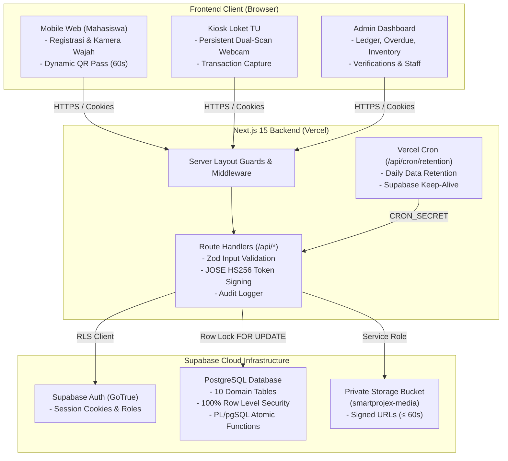

# PINJAM — Sistem Peminjaman Proyektor Pintar (SmartProjex)

[](https://github.com/keegangibran/PINJAM/releases/tag/v1.0.0)
[](https://nextjs.org/)
[](https://react.dev/)
[](https://www.typescriptlang.org/)
[](https://tailwindcss.com/)
[](https://supabase.com/)
[](#18-testing)
[](#21-project-status)

PINJAM (SmartProjex) adalah aplikasi web modern berbasis *dual-scan* (QR Pass Mahasiswa dan QR Unit Proyektor) untuk mendigitalkan seluruh siklus peminjaman dan pengelolaan inventaris proyektor di lingkungan perguruan tinggi (khususnya FMIPA Universitas Negeri Medan / UNIMED). Aplikasi ini mengeliminasi kebutuhan pencatatan buku besar kertas dan penitipan kartu identitas fisik (KTP/KTM) melalui pencatatan digital otomatis, verifikasi kamera mandiri dengan panduan framing visual, konfirmasi kondisi satu langkah, dan dokumentasi foto serah terima unit proyektor.

---

## Daftar Isi
1. [Project Title](#pinjam--sistem-peminjaman-proyektor-pintar-smartprojex)
2. [Project Description](#2-project-description)
3. [Project Overview](#3-project-overview)
4. [Problem Statement](#4-problem-statement)
5. [Project Objectives](#5-project-objectives)
6. [Key Features](#6-key-features)
7. [User Roles](#7-user-roles)
8. [Application Screenshots](#8-application-screenshots)
9. [System Architecture](#9-system-architecture)
10. [Technology Stack](#10-technology-stack)
11. [Project Structure](#11-project-structure)
12. [Database Architecture](#12-database-architecture)
13. [Security and Privacy](#13-security-and-privacy)
14. [Installation Guide](#14-installation-guide)
15. [Environment Variables](#15-environment-variables)
16. [Database Setup](#16-database-setup)
17. [Running Locally](#17-running-locally)
18. [Testing](#18-testing)
19. [Deployment Guide](#19-deployment-guide)
20. [Project Documentation](#20-project-documentation)
21. [Project Status](#21-project-status)
22. [Version Information](#22-version-information)
23. [Contributors](#23-contributors)

---

## 2. Project Description
PINJAM (SmartProjex) mentransformasi tata kelola peminjaman sarana perkuliahan kampus menjadi sistem terintegrasi yang cepat, transparan, dan aman. Dengan menggabungkan teknologi web responsif di sisi klien dan kapabilitas backend serverless Supabase, PINJAM memungkinkan mahasiswa ketua kelas mengambil proyektor dalam waktu singkat (target ≤ 15 detik) hanya dengan memindai QR Pass berumur 60 detik di depan webcam meja layanan TU.

## 3. Project Overview
- **Nama Aplikasi**: PINJAM (SmartProjex)
- **Repositori**: `keegangibran/PINJAM`
- **Versi Terkini**: `v1.0.0`
- **Target Pengguna**: Mahasiswa Ketua Kelas, Staf Tata Usaha (Operator Loket TU), dan Administrator Sistem.
- **Platform**: Web Responsif (Mobile-first untuk QR Pass Mahasiswa, Desktop/Dual-Monitor untuk Kiosk Loket TU dan Dashboard Admin).

## 4. Problem Statement
Sebelum kehadiran PINJAM, operasional peminjaman proyektor di loket TU menghadapi sejumlah kendala:
1. **Antrean Panjang**: Proses manual menulis di buku besar dan tanda tangan memakan waktu 2–3 menit per transaksi.
2. **Penitipan KTP Fisik**: Mahasiswa wajib menitipkan KTP asli sebagai jaminan, menimbulkan risiko kartu tertukar, rusak, atau hilang.
3. **Ketiadaan Visibilitas Inventaris Realtime**: Staf TU kesulitan mengetahui secara pasti unit mana yang tersedia, sedang dibawa, atau terlambat dikembalikan.
4. **Sengketa Kerusakan Unit**: Ketiadaan dokumentasi foto kondisi fisik saat serah terima menyulitkan pembuktian jika terjadi kerusakan kabel atau unit.

## 5. Project Objectives
- **Memangkas Durasi Layanan**: Menurunkan waktu serah terima unit proyektor menjadi rata-rata ≤ 15 detik untuk transaksi normal.
- **Nir-Jaminan Fisik (*Zero Physical Collateral*)**: Menggantikan penitipan KTP fisik 100% dengan identifikasi digital dan pelacakan batas waktu pengembalian (`due_at`).
- **Transparansi & Akuntabilitas**: Menyediakan buku besar digital dengan dokumentasi foto dan jejak audit (*audit logs*) untuk setiap peristiwa sistem.
- **Integritas Penegakan Aturan**: Menegakkan batas peminjaman maksimal 1 unit proyektor aktif per ketua kelas di tingkat basis data.

---

## 6. Key Features

### FT-00 — Registrasi Mandiri & Verifikasi Kamera
- Pendaftaran mandiri mahasiswa dengan pemilihan rombel dari daftar kelas baku (mencegah salah ketik rombel).
- Panduan penempatan wajah (*face framing detection*) berbasis visual oval tanpa inferensi biometrik otomatis.
- Pemotretan dokumen identitas (KTM atau KTP, perlakuan setara) secara langsung via kamera perangkat tanpa unggah berkas galeri.
- **Bebas Efek Mirror**: Seluruh pratinjau kamera dan hasil tangkapan diproses tanpa pembalikan horizontal (`scaleX(-1)` dilarang).
- Antrean verifikasi admin dengan 3 centang pemeriksaan manual wajib (`face_match`, `name_match`, `status_confirmed`).
- **Penghapusan Dokumen Instan**: Berkas foto dokumen KTM/KTP dihapus permanen dari storage segera setelah keputusan admin (Approve/Reject/Resubmission) untuk melindungi privasi.

### FT-01 — QR Pass Mahasiswa & Pengalihan Jabatan
- Akses eksklusif bagi mahasiswa berstatus `ACTIVE` yang menjabat sebagai ketua kelas aktif pada semester berjalan.
- Token QR Pass bertanda tangan HMAC-SHA256 (`HS256`) dengan masa berlaku 60 detik yang diperbarui otomatis di layar ponsel (tanpa memuat NIM pada payload).
- Tombol **Cabut QR** mandiri untuk membatalkan seluruh QR sebelumnya secara seketika (*instant revocation*).
- Fitur **Alihkan Jabatan (*Transfer Leader*)** kepada rekan sekelas yang berstatus `ACTIVE` dalam satu transaksi atomik.

### FT-02 — Dual-Scan Kiosk Meja Loket TU
- Antarmuka Kiosk mandiri yang dibuka pada tab terpisah (`target="_blank"`) dan mendukung monitor kedua serta mode layar penuh (*Fullscreen API*).
- Pemindaian terus-menerus (*continuous scan*) menggunakan siklus kamera webcam laptop yang persisten.
- **Smart Toggle**: Sistem secara otomatis menentukan alur **Peminjaman** jika unit `AVAILABLE`, atau alur **Pengembalian** jika unit `BORROWED`.
- Pengambilan foto dokumentasi serah terima dan konfirmasi kondisi satu langkah ("Normal" vs "Laporkan Kendala").
- Pengembalian fleksibel oleh peminjam sendiri atau perwakilan mahasiswa.
- **Jalur Cadangan (*Manual Lookup*)**: Pencarian manual ketua kelas berfoto referensi jika ponsel mahasiswa kehabisan daya atau sinyal terputus.
- Proteksi `idempotency_key` untuk mencegah transaksi ganda akibat klik ganda atau koneksi putus-sambung.

### FT-03 — Buku Besar Digital & Manajemen Inventaris
- Kartu metrik realtime: Total Unit, Unit Tersedia, Sedang Dipinjam, Terlambat, dan Dalam Perawatan.
- Daftar peminjaman terlambat (*overdue tracking*) dengan filter dinamis.
- Riwayat transaksi komprehensif dengan penampil foto dokumentasi melalui *Signed URL* privat berdurasi ≤ 60 detik (tercatat di audit log).
- Pengelolaan status inventaris proyektor (`AVAILABLE`, `BORROWED`, `MAINTENANCE`, `INACTIVE`) dan pencetakan stiker QR unik per unit.
- Ekspor riwayat transaksi ke format berkas CSV.

### FT-04 — Manajemen Rombel Kelas & Semester
- Pengelolaan struktur kelas baku (Program Studi, Angkatan, Rombel, Semester Akademik).
- Salin kelas antar-semester (*copy term*) secara massal tanpa menyertakan ketua kelas lama.
- Antrean persetujuan klaim ketua kelas (`INITIAL`, `REPLACEMENT`, `TRANSFER`).
- Pelepasan jabatan ketua kelas secara manual oleh Administrator dengan pencatatan alasan wajib.

---

## 7. User Roles

Sistem menerapkan prinsip *least privilege* dengan pemisahan peran ketat di sisi server:

| Peran | Deskripsi | Akses Halaman |
|---|---|---|
| **Mahasiswa (`ACTIVE`)** | Ketua kelas aktif yang meminjam proyektor untuk kegiatan perkuliahan rombelnya. | Portal Mahasiswa (`/my-qr`, `/register`) |
| **Petugas Loket (`STAFF`)** | Staf tata usaha yang mengoperasikan meja layanan, Kiosk scanner, dan verifikasi mahasiswa. | Kiosk Loket (`/kiosk`), Verifikasi (`/admin/verifications`), Dashboard (`/admin`) |
| **Administrator (`ADMIN`)** | Kepala TU atau admin IT dengan hak penuh atas master data, inventaris, akun staf, dan audit log. | Seluruh menu administrasi (`/admin/*`) dan Kiosk (`/kiosk`) |

---

## 8. Application Screenshots

<!-- TODO: Tambahkan screenshot Landing Page di sini. -->
<!-- TODO: Tambahkan screenshot Dashboard Admin di sini. -->
<!-- TODO: Tambahkan screenshot Dashboard Mahasiswa (QR Pass) di sini. -->
<!-- TODO: Tambahkan screenshot Alur Registrasi Mandiri di sini. -->
<!-- TODO: Tambahkan screenshot Antrean Verifikasi Mahasiswa di sini. -->
<!-- TODO: Tambahkan screenshot Kiosk Dual-Scan di sini. -->
<!-- TODO: Tambahkan screenshot Manajemen Inventaris Proyektor di sini. -->
<!-- TODO: Tambahkan screenshot Riwayat Buku Besar Peminjaman di sini. -->

---

## 9. System Architecture



---

## 10. Technology Stack

- **Framework**: [Next.js 15.5.29](https://nextjs.org/) (App Router, Server Route Handlers, Server Actions)
- **Frontend Library**: [React 19.0.0](https://react.dev/)
- **Bahasa Pemrograman**: [TypeScript 5.9.3](https://www.typescriptlang.org/) (Strict Mode)
- **Styling**: [Tailwind CSS 3.4.1](https://tailwindcss.com/)
- **Basis Data**: [Supabase PostgreSQL](https://supabase.com/) dengan Row Level Security (RLS) aktif 100%
- **Autentikasi**: Supabase Auth (GoTrue) berbasis HttpOnly session cookies
- **Penyimpanan Berkas**: Supabase Storage (Private Bucket `smartprojex-media`)
- **Penandatanganan Token QR**: [JOSE 5.9.6](https://github.com/panva/jose) (HMAC-SHA256 / HS256)
- **Pemindai QR Kamera**: [html5-qrcode 2.3.8](https://github.com/mebjas/html5-qrcode)
- **Pembangkit QR Code**: [qrcode.react 4.2.0](https://github.com/zpao/qrcode.react)
- **Validasi Skema**: [Zod 3.24.1](https://zod.dev/)
- **Test Suite**: [Vitest 3.2.7](https://vitest.dev/)
- **Hosting & Deployment**: [Vercel](https://vercel.com/) (Hobby / Pro)

---

## 11. Project Structure

```text
smartprojex/
├── docs/                        # Dokumentasi teknis, klarifikasi, dan UAT
│   ├── uat/                     # Matriks UAT, runbook, dan checklist
│   └── PRD-CLARIFICATIONS.md    # Keputusan desain dan klarifikasi celah spesifikasi
├── src/
│   ├── app/                     # Next.js 15 App Router
│   │   ├── (auth)/              # Halaman autentikasi terpusat (/login)
│   │   ├── (student)/           # Area mahasiswa (/register, /my-qr)
│   │   ├── admin/               # Area administrasi (/admin/*)
│   │   ├── kiosk/               # Antarmuka meja layanan Kiosk (/kiosk)
│   │   └── api/                 # Route Handlers serverless (/api/*)
│   ├── components/              # Komponen antarmuka modular
│   │   ├── admin/               # Tampilan dashboard, inventaris, dan audit log
│   │   ├── auth/                # Formulir login universal berbasis peran
│   │   ├── kiosk/               # Pemindai kamera dan alur transaksi loket
│   │   ├── registration/        # Tahapan pemotretan wajah dan dokumen kartu
│   │   └── ui/                  # Komponen fondasi desain (Card, Modal, Input, Button)
│   └── lib/                     # Utilitas inti dan logika domain
│       ├── auth/                # Guard otorisasi peran dan penanganan sesi
│       ├── supabase/            # Klien Supabase (Browser, Server, Admin)
│       ├── audit.ts             # Pencatatan append-only audit log
│       ├── face-detection.ts    # Deteksi visual framing kamera
│       ├── kiosk-workflow.ts    # State machine alur loket Kiosk
│       └── qr-token.ts          # Penandatanganan dan verifikasi token HS256
├── supabase/
│   └── migrations/              # 6 Skrip migrasi DDL & DCL PostgreSQL
├── tests/                       # Test suite Vitest (56 file pengujian)
│   ├── unit/                    # Unit tests API, komponen UI, dan utilitas
│   └── integration/             # Integration tests alur transaksi atomik
├── PRD.md                       # Product Requirements Document resmi v1.0.0
├── README.md                    # Dokumentasi pengenalan repositori
├── package.json                 # Dependensi proyek
└── vercel.json                  # Konfigurasi Vercel Cron harian
```

---

## 12. Database Architecture

Basis data PINJAM dibangun di atas Supabase PostgreSQL menggunakan 6 berkas migrasi SQL berurutan tanpa operasi destruktif (`DROP TABLE` = 0):

| No | File Migrasi | Deskripsi & Isi Inti |
|---|---|---|
| 1 | `20261106000001_initial_schema.sql` | Ekstensi `uuid-ossp`, trigger `handle_updated_at`, 10 tabel domain (`staff_profiles`, `classes`, `students`, `class_leader_claims`, `projectors`, `loans`, `projector_status_logs`, `audit_logs`, `kiosk_sessions`, `app_settings`), dan partial unique indexes. |
| 2 | `20261106000002_rls_policies.sql` | Helper functions `is_active_staff()`, `is_active_admin()`, pengaktifan RLS pada seluruh 10 tabel domain (100%), dan kebijakan least-privilege. |
| 3 | `20261106000003_storage_setup.sql` | Pembuatan bucket privat `smartprojex-media` (maks. 2 MB, tipe MIME JPEG/PNG/WebP), serta RLS storage objects. |
| 4 | `20261106000004_atomic_transactions.sql` | Fungsi atomik PL/pgSQL `process_loan_transaction` (`SECURITY DEFINER`, row locking `FOR UPDATE`, Smart Toggle, idempotensi). |
| 5 | `20261106000005_class_leader_transfer.sql` | Fungsi atomik `transfer_class_leader` dan `revoke_student_qr_pass`. |
| 6 | `20261106000006_security_hardening.sql` | Pencabutan hak eksekusi dari publik/klien, pembatasan eksekusi fungsi ke `service_role`, penegakan `search_path = public, pg_temp`, dan cron maintenance data retention. |

### Penegakan Integritas Parsial di Tingkat Database
- `UNIQUE (nim) WHERE registration_status = 'ACTIVE'`: Memastikan hanya 1 akun aktif per NIM.
- `UNIQUE (projector_id) WHERE status = 'ACTIVE'`: Mencegah unit proyektor dipinjam lebih dari 1 kali secara bersamaan.
- `UNIQUE (student_id) WHERE status = 'ACTIVE'`: Mencegah ketua kelas memiliki lebih dari 1 pinjaman aktif secara bersamaan.
- `UNIQUE (class_id) WHERE claim_type = 'INITIAL' AND status = 'PENDING'`: Mencegah calon ketua awal ganda per rombel kelas.

---

## 13. Security and Privacy

1. **Role-Based Access Control (RBAC)**: Proteksi di sisi server menggunakan Server Layout Guards (`requireStaff()`, `requireAdmin()`) dan Row Level Security (RLS) di seluruh tabel basis data.
2. **Penyimpanan Foto Privat & Signed URL Singkat**: Foto wajah dan foto transaksi disimpan dalam bucket privat. Akses hanya dapat dibuka melalui *Signed URL* berdurasi maksimal 60 detik yang setiap pembuatannya dicatat ke dalam `audit_logs`.
3. **Penghapusan Instan Dokumen Identitas**: Foto KTM/KTP dihapus permanen dari storage seketika keputusan verifikasi admin dibuat. Sistem tidak pernah menyimpan NIK atau teks bacaan OCR.
4. **Privasi Kamera & Anti-Mirror**: Deteksi wajah hanya berfungsi sebagai panduan penempatan (*framing*) visual tanpa analisis biometrik. Seluruh kamera diproses normal tanpa pembalikan horizontal (`scaleX(-1)` dilarang).
5. **Keamanan Token QR Dinamis**: Token bertanda tangan kriptografis HS256 berumur 60 detik tanpa memuat NIM mahasiswa. Token dapat dicabut sewaktu-waktu via fitur Cabut QR.
6. **Pembersihan Otomatis Data Retensi**: Tugas terjadwal Vercel Cron (`/api/cron/retention`) berjalan harian untuk membersihkan foto transaksi selesai berumur > 180 hari dan akun nonaktif > 90 hari.

---

## 14. Installation Guide

### Prasyarat Sistem
- Node.js versi 18.18+ atau 20.x
- npm versi 9.x atau yang lebih baru
- Akun dan proyek di [Supabase Cloud](https://supabase.com/)

### Langkah Instalasi
1. Klon repositori PINJAM:
   ```bash
   git clone https://github.com/keegangibran/PINJAM.git
   cd PINJAM
   ```
2. Pasang seluruh dependensi proyek:
   ```bash
   npm install
   ```

---

## 15. Environment Variables

Salin berkas template lingkungan `.env.example` menjadi `.env.local`:
```bash
cp .env.example .env.local
```

Isi variabel lingkungan berikut pada `.env.local` (DILARANG melakukan commit berkas ini ke Git):

| Variabel | Lingkup | Deskripsi |
|---|---|---|
| `NEXT_PUBLIC_SUPABASE_URL` | Publik (Client & Server) | URL API proyek Supabase Anda (`https://[project-id].supabase.co`). |
| `NEXT_PUBLIC_SUPABASE_ANON_KEY` | Publik (Client & Server) | Anon public key dari proyek Supabase Anda. |
| `SUPABASE_SERVICE_ROLE_KEY` | Rahasia (Server-Only) | Service role key Supabase untuk eksekusi fungsi administratif. |
| `QR_TOKEN_SECRET` | Rahasia (Server-Only) | String acak kriptografis minimal 32 karakter untuk tanda tangan HS256 QR Pass. |
| `CRON_SECRET` | Rahasia (Server-Only) | Kunci otentikasi pengamanan endpoint Vercel Cron harian. |
| `NEXT_PUBLIC_APP_TIMEZONE` | Publik (Client & Server) | Pengaturan zona waktu standar aplikasi (`Asia/Jakarta`). |
| `NEXT_PUBLIC_SITE_URL` | Publik (Client & Server) | URL basis aplikasi (misal `http://localhost:3000` untuk pengembangan lokal). |

---

## 16. Database Setup

1. Buka **SQL Editor** pada Dashboard proyek Supabase Anda.
2. Jalankan ke-6 berkas migrasi SQL secara berurutan dari folder `supabase/migrations/`:
   - `20261106000001_initial_schema.sql`
   - `20261106000002_rls_policies.sql`
   - `20261106000003_storage_setup.sql`
   - `20261106000004_atomic_transactions.sql`
   - `20261106000005_class_leader_transfer.sql`
   - `20261106000006_security_hardening.sql`
3. Konfigurasikan bucket penyimpanan: pastikan bucket `smartprojex-media` telah dibuat dengan status **Private** dan ukuran maksimal 2 MB.

---

## 17. Running Locally

Jalankan server pengembangan lokal:
```bash
npm run dev
```

Buka peramban pada alamat `http://localhost:3000`.

> [!TIP]
> **Panduan Pengujian Multi-Peran**:
> Untuk menguji interaksi simultan antara Administrator loket dan Mahasiswa pendaftar, gunakan **dua profil peramban yang berbeda** (misal Chrome Profile 1 untuk Admin dan Mode Samaran / Chrome Profile 2 untuk Mahasiswa) agar cookie sesi autentikasi tidak saling menimpa.

---

## 18. Testing

PINJAM dilengkapi dengan rangkaian pengujian otomatis (*automated test suite*) berbasis Vitest:

```bash
# Menjalankan seluruh test suite Vitest
npm test

# Menjalankan pemeriksaan tipe TypeScript secara strict
npm run typecheck

# Memeriksa standar kode dengan ESLint
npm run lint

# Memverifikasi build produksi Next.js
npm run build
```

**Hasil Pengujian Terkini (v1.0.0 Release Baseline)**:
- **Automated Tests (Vitest)**: **56 test files lulus, 551 tests lulus 100%** (0 error).
- **TypeScript Typecheck**: **0 error** (`tsc --noEmit`).
- **Next.js Production Build**: **41 routes compiled successfully**.
- **Controlled Staging Integration UAT**: **37/37 skenario lulus di Vercel Staging** (terdiri atas 25 skenario integrasi alur kerja/RBAC dan 12 skenario simulasi muatan citra/transaksi Kiosk pada level API).
- **Pengujian Perangkat Keras Fisik Loket**: Dijadwalkan saat pilot operasional kampus (Fase 0 Pilot bersama staf TU).

---

## 19. Deployment Guide

- **Development**: Dijalankan secara lokal di komputer pengembang.
- **Staging**: Terhubung ke branch `staging` di Vercel Preview dengan basis data staging terpisah.
- **Production**: Terhubung ke branch `main` dengan tag rilis resmi `v1.0.0`.

> [!IMPORTANT]
> **Status Deployment Produksi**:
> Kode sumber PINJAM versi **v1.0.0** telah resmi dirilis pada repositori GitHub di branch `main`. Namun, peluncuran langsung (*live production deployment*) saat ini masih berstatus **tertahan (*held*)** menunggu penyediaan proyek Supabase Production terpisah, konfigurasi Custom SMTP, penetapan domain kampus resmi, dan penyerahan akun administrator pertama oleh pihak pengelola kampus.

---

## 20. Project Documentation

Dokumentasi lengkap proyek dapat ditelusuri melalui tautan berikut:
- [Product Requirements Document (PRD v1.0.0)](./PRD.md)
- [PRD Clarifications & Design Decisions](./docs/PRD-CLARIFICATIONS.md)
- [Final UAT Closure Report (Stage 24.13)](./PINJAM_STAGE24_13_FINAL_UAT_CLOSURE.md)
- [Production Migration Preparation (Stage 25.2)](./PINJAM_STAGE25_2_PRODUCTION_MIGRATION_PREPARATION.md)
- [Production Infrastructure Preparation (Stage 25.3)](./PINJAM_STAGE25_3_PRODUCTION_INFRASTRUCTURE_PREPARATION.md)
- [Production Release Preparation (Stage 25.4)](./PINJAM_STAGE25_4_PRODUCTION_RELEASE_PREPARATION.md)
- [Production Release Report (Stage 25.5)](./PINJAM_STAGE25_5_PRODUCTION_RELEASE_REPORT.md)
- [Production Infrastructure Readiness (Stage 25.6)](./PINJAM_STAGE25_6_PRODUCTION_INFRASTRUCTURE_READINESS.md)

---

## 21. Project Status

```text
================================================================================
STATUS PROYEK: GIT v1.0.0 RELEASED (PRODUCTION DEPLOYMENT PENDING)
================================================================================
- Pengembangan Fitur (FT-00 s.d. FT-04): Selesai (IMPLEMENTED 100%)
- Automated Tests: 551/551 Tests Passed (100% Lulus)
- Controlled Staging UAT: 37/37 Skenario Passed di Vercel Staging
  (25 Skenario Integrasi Alur Kerja & 12 Skenario Simulasi Payload Transaksi)
- Pengujian Perangkat Fisik & Loket Nyata: Dijadwalkan saat pilot operasional kampus
- Git Release: Branch main & Tag v1.0.0 resmi diterbitkan di GitHub
- Live Production Deployment: Tertahan (Menunggu penyediaan infrastruktur resmi)
================================================================================
```

---

## 22. Version Information

- **Versi**: `v1.0.0`
- **Tanggal Rilis Git**: 24 November 2026
- **Commit SHA**: `c5449e27f441e43cc5ba30fade6431381f2043d8`
- **Tag Rilis**: `v1.0.0`
- **Branch**: `main`

---

## 23. Contributors

Proyek PINJAM (SmartProjex) dikembangkan dan dipelihara oleh:
- **Keegan Gibran** ([@keegangibran](https://github.com/keegangibran)) — Lead Developer & Repository Owner
- **Tim Pengembang & Asisten AI Antigravity** — Software Architecture, Implementation, Testing & Technical Documentation

---

*Hak Cipta © 2026 PINJAM (SmartProjex). Lisensi dan penggunaan diatur sesuai ketentuan internal perguruan tinggi.*
