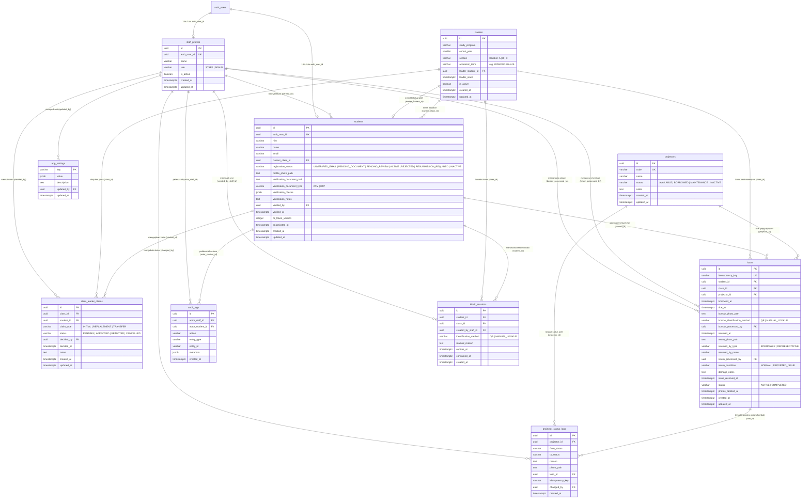

# SmartProjex — Entity Relationship Diagram (ERD)

Dokumen ini memodelkan seluruh entitas, relasi, atribut, dan batasan integritas basis data SmartProjex (PostgreSQL / Supabase) berdasarkan PRD Revisi 3.

---

## 1. Diagram Relasi Entitas (Mermaid)

---

## 2. Invariant Kritis & Partial Unique Indexes

1. **Satu NIM Aktif**:
   `CREATE UNIQUE INDEX idx_students_active_nim ON students (nim) WHERE registration_status = 'ACTIVE';`
   *Tujuan*: Memungkinkan pendaftar dengan NIM sama masuk antrean verifikasi untuk ditandai duplikasi ke petugas, namun hanya 1 akun yang dapat berstatus `ACTIVE`.

2. **Satu Pinjaman Aktif per Unit Proyektor**:
   `CREATE UNIQUE INDEX idx_loans_active_projector ON loans (projector_id) WHERE status = 'ACTIVE';`
   *Tujuan*: Mencegah unit proyektor yang sama dipinjam lebih dari 1 kali secara bersamaan di tingkat basis data.

3. **Satu Pinjaman Aktif per Mahasiswa (Ketua Kelas)**:
   `CREATE UNIQUE INDEX idx_loans_active_student ON loans (student_id) WHERE status = 'ACTIVE';`
   *Tujuan*: Menegakkan aturan bahwa satu ketua kelas hanya boleh membawa maksimal 1 unit proyektor aktif.

4. **Satu Calon Ketua Awal per Kelas**:
   `CREATE UNIQUE INDEX idx_claims_one_pending_initial ON class_leader_claims (class_id) WHERE claim_type = 'INITIAL' AND status = 'PENDING';`
   *Tujuan*: Menegakkan aturan pendaftar pertama (`INITIAL`) per kelas yang belum punya ketua; pendaftar berikutnya otomatis menjadi `REPLACEMENT`.
